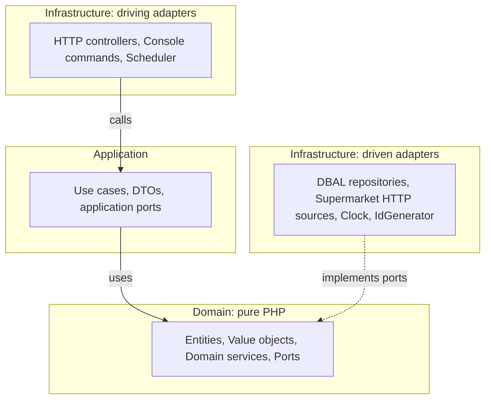
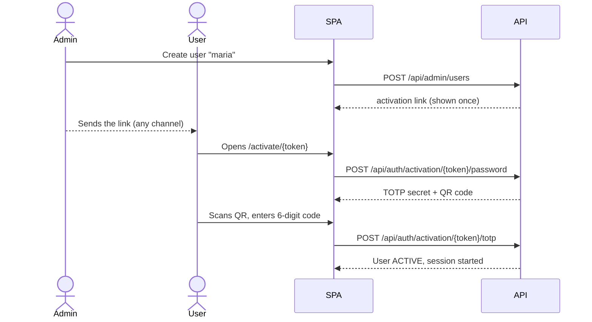
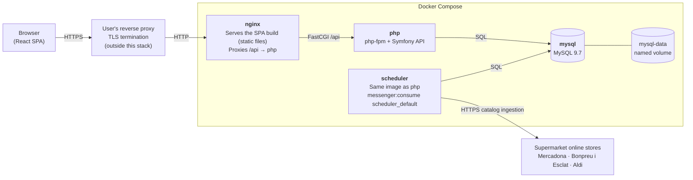

# Architecture

This document is the technical source of truth. If the code and this document disagree, raise it as a question. Do not silently pick one.

## Contents

1. [Product decisions](#product-decisions)
2. [Stack](#stack)
3. [Architecture style](#architecture-style)
4. [Bounded contexts](#bounded-contexts)
5. [Domain model](#domain-model)
6. [Backend structure](#backend-structure)
7. [Frontend structure](#frontend-structure)
8. [Key flows](#key-flows)
9. [HTTP API (draft)](#http-api-draft)
10. [Persistence](#persistence)
11. [Testing strategy](#testing-strategy)
12. [Runtime and deployment](#runtime-and-deployment)
13. [Open questions](#open-questions)

---

## Product decisions

Decisions confirmed by the product owner. Changing any of them requires asking first.

| ID | Decision |
| --- | --- |
| PD-1 | MVP supermarkets: **Mercadona, Bonpreu i Esclat, Aldi**. Each chain is a separate adapter; more chains come later. |
| PD-2 | **User accounts with login.** A shopping list has an **owner** and **members**. It is shared through a **secret link** (unguessable token). Opening the link **requires being logged in** and makes the user a member, so the list appears in their "My lists". The owner sees the members, can remove them and can **regenerate the link** (the old one stops working). *(Supersedes the original "no accounts" decision.)* |
| PD-3 | Comparison is **search + unit price**: a search returns products from every chain, ranked by price per kg / L / unit. There is **no cross-chain product matching** (no EAN grouping). |
| PD-4 | A list item is either **free text** ("leche") or a **concrete product** of a supermarket. Product items show price and contribute to an **estimated total per supermarket**. |
| PD-5 | **One postal code per instance**, set in `.env`. Ingestion fetches prices for that location only. |
| PD-6 | **Price history is stored**: each ingestion run writes dated price snapshots. |
| PD-7 | Collaboration uses **polling** (~5 s) while a list is open. No WebSockets or Mercure. |
| PD-8 | UI language is **Spanish**, with all copy in translation files (i18n ready). Code, comments and technical docs are **English**. |
| PD-9 | The instance is **closed**: the whole app (search included) requires login. There is no self sign-up. *(Supersedes the original "open instance" decision.)* |
| PD-10 | It is a **web app** (SPA). No native mobile app for now. |
| PD-11 | Environment files: the **backend follows the Symfony convention**. `backend/.env` (and `.env.test`) is committed with non-secret defaults. Real values and secrets go in `backend/.env.local`, which is ignored. The **root `.env`** used by Docker Compose is ignored, and a committed `.env.example` documents it. |
| PD-12 | **Users are created by an admin** of the platform. Users log in with a **username** (no email is stored or sent). Creating a user generates a **one-time activation link** that expires. The admin passes it to the user by any channel, and the user sets their password through it on first access. |
| PD-13 | **TOTP two-factor authentication is mandatory for every user.** It is configured on first access, right after setting the password, and nobody can use the app without it. |
| PD-14 | Roles: `ADMIN` (manages users and can also use the app) and `USER`. **First admin (setup):** while the platform has **no users**, the SPA redirects to `/setup`. Using it requires a **one-time setup code** that the backend prints in the container logs at startup, so whoever reaches the URL first cannot take over the instance. After entering the code and a username, the normal activation flow follows (password + TOTP). Once a user exists, `/setup` and its endpoints answer `404` forever. |
| PD-15 | Admin areas are **hidden in the frontend** for non-admins: no links, menu entries or buttons are rendered. If a non-admin still reaches an admin route or endpoint, the API answers `404` and the SPA shows the not-found page. The real protection is the backend; hiding is UX only. |
| PD-16 | Backend runtime: **PHP 8.5** and **MySQL 9.7 LTS** (newest stable PHP branch and newest MySQL LTS when E0 started). *(Supersedes the original PHP 8.4 and MySQL 8.4 LTS choice.)* |
| PD-17 | `GET /api/health` is **public**. It answers `200 {"status":"ok"}` when the database answers, and `503 {"status":"unavailable"}` when it does not. No internal details are exposed. |
| PD-18 | API errors map a small **domain error hierarchy** in `Shared\Domain\Exception` to HTTP: `NotFound` → `404`, `InvalidArgument` → `422`, `Conflict` → `409`. Symfony HTTP errors keep their status (unknown route `404`, wrong method `405`). Any other exception is a `500` with a generic title and **no internal details**, in every environment. Only domain errors include their message as `detail`. |
| PD-19 | `Money` is **never negative**: amounts and multipliers below zero are rejected. A signed amount (price differences, discounts) needs its own decision. |

## Stack

| Concern | Choice | Why |
| --- | --- | --- |
| Language (BE) | PHP 8.5 | Required stack. Readonly classes, enums and property hooks fit value objects well. Newest stable branch (PD-16). |
| Framework (BE) | **Symfony 7.4 LTS** | Long-term support. Its DI container and components (Console, Scheduler, HttpClient, Messenger) can stay strictly in the infrastructure layer. It is less intrusive than Laravel for hexagonal design: no Active Record and no facades. |
| Persistence | **Doctrine DBAL** + Doctrine Migrations | Explicit SQL in infrastructure repositories keeps domain classes free of ORM metadata. Bulk inserts for price snapshots are simple and fast. |
| Database | **MySQL 9.7 LTS** | Required stack (PD-16). `utf8mb4_0900_ai_ci` gives accent- and case-insensitive search. FULLTEXT indexes cover product search. |
| HTTP client | Symfony HttpClient | Used only inside supermarket adapters. Supports retries and mock responses for tests. |
| Scheduling | Symfony Scheduler + Console command | Ingestion runs as a console command, triggered by a scheduler worker container. |
| Authentication | Symfony Security (session cookie) + `scheb/2fa-bundle` with `scheb/2fa-totp` + Symfony RateLimiter | The SPA and the API share the same origin (nginx), so an `HttpOnly`, `Secure`, `SameSite=Lax` session cookie is simpler and safer than JWT in browser storage. `scheb/2fa` is the standard Symfony TOTP integration. Login and 2FA attempts are rate-limited. Passwords are hashed with Symfony's `auto` hasher (bcrypt/argon2id). All of this lives in Infrastructure; the Identity domain is framework-free. |
| Language (FE) | TypeScript (strict) | Required stack. |
| Framework (FE) | **React + Vite** | Mature ecosystem. Fits atomic design and the container/presentational pattern. Vite gives fast dev builds and a static output that nginx serves. |
| Server state (FE) | TanStack Query | Caching, background refetch and **polling** (`refetchInterval`) out of the box, which covers PD-7. |
| Routing (FE) | React Router | Covers `/setup`, `/login`, `/activate/:token`, `/`, `/search`, `/lists/:id`, `/join/:token`, `/admin/users`, with route guards for authenticated and admin areas. |
| i18n (FE) | react-i18next | Covers PD-8. |
| Styling (FE) | **Tailwind CSS** (Vite plugin) + `class-variance-authority` + `tailwind-merge` | Design tokens (colors, spacing, typography, radii) are defined once in the Tailwind theme. Only values from that scale are used, which keeps the UI consistent. Component variants are declared in one place with `cva`. Class conflicts are resolved with `tailwind-merge`. No runtime CSS-in-JS. |
| BE quality | PHPUnit, PHPStan (max), **Deptrac** (layer rules), PHP-CS-Fixer, Infection (mutation testing, optional gate) | Deptrac enforces the hexagonal dependency rule in CI. |
| FE quality | Vitest, Testing Library, MSW, Playwright, ESLint, Prettier, `tsc --noEmit` | |
| Runtime | Docker Compose: `nginx`, `php` (fpm), `scheduler`, `mysql` | Single-host self-hosting. |

### Pinned versions

Pinned in [E0](epics/E0-foundation.md) to the latest stable patch, checked on 2026-11-06 against the official sources. Bump them deliberately, one at a time, with the full `composer check` passing.

| Component | Version | Pinned in | Source |
| --- | --- | --- | --- |
| PHP (fpm, Alpine image) | 8.5.12 | `docker/php/Dockerfile`, `config.platform` in `backend/composer.json` | [php.net](https://www.php.net/supported-versions.php) |
| Symfony | 7.4 LTS (7.4.23 at pin time) | `extra.symfony.require: 7.4.*` in `backend/composer.json`; exact patch in `composer.lock` | [symfony.com/releases](https://symfony.com/releases) |
| MySQL | 9.7.4 LTS | `compose.yaml`, `server_version` in `backend/config/packages/doctrine.yaml` | [dev.mysql.com](https://dev.mysql.com/doc/relnotes/mysql/9.7/en/) |
| nginx | 1.30.6 (stable) | `compose.yaml` | [nginx.org](https://nginx.org/en/download.html) |
| Composer | 2.11.1 | `docker/php/Dockerfile` | [getcomposer.org](https://getcomposer.org/download/) |
| Xdebug (optional) | 3.5.3 | `docker/php/Dockerfile` | [pecl.php.net](https://pecl.php.net/package/xdebug) |

Backend libraries (PHPUnit, PHPStan, PHP-CS-Fixer, Deptrac, Doctrine) are locked in `backend/composer.lock`. Frontend versions (Node LTS, React, Vite) are pinned when the frontend is bootstrapped.

## Architecture style

**Hexagonal architecture (ports and adapters)** combined with **screaming architecture**: top-level folders are named after business capabilities, not technical layers.



Solid arrows are calls, and dashed arrows are interface implementations. Every dependency points **inwards**: Domain knows nothing about the other boxes.

### Dependency rules (enforced by Deptrac)

| Layer | May depend on | Must never depend on |
| --- | --- | --- |
| `Domain` | `Shared\Domain` only | Application, Infrastructure, Symfony, Doctrine, any vendor |
| `Application` | Domain, `Shared\Domain`, `Shared\Application` | Infrastructure, Symfony, Doctrine |
| `Infrastructure` | Everything above + vendor | — |
| Context A | Context B **only** through B's `Application` public API (query services) | B's Domain or Infrastructure |

### Rules of thumb

- **Ports** are interfaces owned by the inner layer (`Domain` for repositories and domain-facing collaborators, `Application` for application concerns such as a transaction manager).
- **Adapters** live in `Infrastructure` and implement ports.
- **Use cases** have one public method (`__invoke`), receive a command/query DTO and return a DTO or nothing. They never return entities to controllers.
- **Entities** protect their invariants. No public setters. They are created through named constructors.
- **Value objects** are immutable, `final readonly` and self-validating.
- **Money** is stored as integer cents. Floats are never used for money.
- **Time and IDs** come from ports (`Clock`, `IdGenerator`) so tests stay deterministic.
- **Controllers** only map HTTP ↔ DTOs and call a use case.

## Bounded contexts

| Context | Responsibility | Main aggregates |
| --- | --- | --- |
| **Catalog** | Supermarkets, their products, current prices, price history, ingestion from external sources, search and comparison. | `Supermarket`, `Product` |
| **Identity** | Users, roles, activation links, password, mandatory TOTP 2FA, login. | `User` |
| **ShoppingList** | Lists with owner and members, joining through the secret link, items (free text or product reference), checking items, per-supermarket totals. | `ShoppingList` |
| **Shared** | Shared kernel: `Money`, `Uuid`, `UserId`, `Clock`, base exceptions. Kept minimal. | — |

`ShoppingList` reads product data (name, price, supermarket) through a **Catalog query port** (`ProductCatalog` interface in ShoppingList's Application layer, implemented in Infrastructure by calling Catalog's application query service). It never imports Catalog domain classes.

`ShoppingList` only knows users by `UserId` (shared kernel). The current user reaches use cases as an explicit `actorId` in each command/query. Use cases never read Symfony's security token; the controller extracts the id and passes it in. Display names of members are read through a `UserDirectory` port implemented on top of Identity's application query service.

## Domain model

### Catalog

```text
Supermarket (aggregate root)
  id: SupermarketId            e.g. "mercadona", "bonpreu", "aldi" (stable slug)
  name: string
  enabled: bool

Product (aggregate root)
  id: ProductId                internal UUID
  supermarketId: SupermarketId
  externalId: ExternalProductId  id in the supermarket's store (unique per supermarket)
  name: ProductName
  brand: ?string
  category: ?CategoryPath
  imageUrl: ?Url
  packaging: Packaging         quantity + unit (e.g. 1 L, 500 g, 6 units)
  currentPrice: Money
  unitPrice: UnitPrice         Money per UnitOfMeasure (kg | L | unit)
  lastSeenAt: DateTimeImmutable
  available: bool              false when the last ingestion did not return it

PriceSnapshot (entity, append-only)
  productId, price: Money, unitPrice: UnitPrice, capturedAt
```

Value objects: `Money` (cents and currency, EUR only for now), `Packaging`, `UnitOfMeasure` (enum: `KILOGRAM`, `LITRE`, `UNIT`), `UnitPrice`, `ProductName`, `ExternalProductId`, `PostalCode`.

**Unit normalization:** grams → kg, ml/cl → L, and "pack of N" → unit. When a source gives its own unit price, store it and also compute ours. If they disagree, ours wins and a warning is logged. If packaging cannot be parsed, the product is stored **without** a unit price and ranked last. That is an explicit state, not a guess.

**Ports (Catalog Domain):**

- `ProductRepository`: save, find by `(supermarketId, externalId)`, search.
- `PriceSnapshotRepository`: append, history by product.
- `SupermarketCatalogSource`: `fetchCatalog(PostalCode): iterable<SourceProduct>`. **One adapter per chain.**

### Identity

```text
User (aggregate root)
  id: UserId
  username: Username           unique, case-insensitive, normalized to lowercase
  role: Role                   ADMIN | USER
  status: UserStatus           PENDING_ACTIVATION | ACTIVE | DISABLED
  passwordHash: ?PasswordHash  null until activated (hashing is a port, never done in the domain)
  totp: ?TotpEnrollment        secret (encrypted at rest) + confirmedAt; required before ACTIVE
  activation: ?ActivationToken hash of the one-time token + expiresAt; consumed on use
  createdAt, createdBy: ?UserId
```

Lifecycle: `PENDING_ACTIVATION` → (valid activation link → set password → scan the TOTP QR code → confirm a code) → `ACTIVE`. Only the **hash** of the activation token is stored. The plain token appears only once, in the link shown to the admin.

**Ports (Identity):** `UserRepository`, `PasswordHasher`, `TotpService` (generate secret, verify code), `ActivationTokenGenerator`, `SecretEncrypter`.

### ShoppingList

```text
ShoppingList (aggregate root)
  id: ShoppingListId           internal UUID
  ownerId: UserId
  members: UserId[]            users who joined through the link (owner excluded)
  shareToken: ShareToken       ≥128-bit random, URL-safe; the "secret link" used only to JOIN
  name: string
  items: ListItem[]
  createdAt, updatedAt
  version: int                 incremented on every change (used for ETag)

ListItem (entity inside the aggregate)
  id: ListItemId
  content: FreeTextItem(text) | ProductItem(productId, supermarketId)
  quantity: positive int
  checked: bool
  position: int
```

**Access rules:** owner and members can read and edit items. Only the owner can rename the list, remove members and regenerate the share token. Joining with a valid token is idempotent, and joining your own list is a no-op.

**Totals:** the estimated total per supermarket is the sum of `price × quantity` of product items belonging to that supermarket. Free-text items are listed but not priced. It is computed in the Application layer with a fresh price from the `ProductCatalog` port.

## Backend structure

```text
backend/
├── src/
│   ├── Catalog/
│   │   ├── Domain/
│   │   │   ├── Model/           # Supermarket, Product, PriceSnapshot
│   │   │   ├── ValueObject/     # Packaging, UnitPrice, UnitOfMeasure...
│   │   │   ├── Port/            # ProductRepository, SupermarketCatalogSource...
│   │   │   ├── Service/         # UnitPriceCalculator (pure)
│   │   │   └── Exception/
│   │   ├── Application/
│   │   │   ├── IngestCatalog/   # IngestCatalogCommand + IngestCatalogHandler
│   │   │   ├── SearchProducts/  # SearchProductsQuery + handler + result DTO
│   │   │   └── GetPriceHistory/
│   │   └── Infrastructure/
│   │       ├── Persistence/Dbal/
│   │       ├── Source/Mercadona/
│   │       ├── Source/BonpreuEsclat/
│   │       ├── Source/Aldi/
│   │       ├── Http/            # controllers
│   │       └── Console/         # app:catalog:ingest
│   ├── Identity/
│   │   ├── Domain/ Application/ Infrastructure/   # same layout; Symfony Security + scheb/2fa adapters live in Infrastructure/Security
│   ├── ShoppingList/
│   │   ├── Domain/ Application/ Infrastructure/   # same layout
│   └── Shared/
│       ├── Domain/              # Clock port, ValueObject/ (Money, Currency, Uuid), Exception/ (PD-18)
│       ├── Application/
│       └── Infrastructure/      # SystemClock, RandomTokenGenerator, Symfony kernel glue
├── tests/
│   ├── Unit/                    # Domain + Application, in-memory fakes, no I/O
│   ├── Integration/             # DBAL repos vs real MySQL, adapters vs recorded fixtures
│   ├── Functional/              # HTTP API through Symfony kernel
│   └── Fixtures/                # recorded supermarket responses (JSON/HTML)
├── migrations/
├── config/
└── deptrac.yaml
```

Test folders mirror `src/` (for example, `tests/Unit/Catalog/Domain/ValueObject/PackagingTest.php`). Reusable test doubles of shared ports live in `tests/Support/` (for example `FixedClock`).

### Shared kernel

| Class | Notes |
| --- | --- |
| `Shared\Domain\ValueObject\Money` | Integer cents, `Currency::EUR` only. `eur()`, `add()`, `multiply(int)`, `equals()`, `compareTo()`, `isGreaterThan()`, `isLessThan()`. Never negative (PD-19). |
| `Shared\Domain\ValueObject\Uuid` | Canonical `8-4-4-4-12` hex string, normalized to lowercase. It only validates; generation belongs to an `IdGenerator` port. |
| `Shared\Domain\Clock` | Port returning the current `DateTimeImmutable`. `Shared\Infrastructure\Clock\SystemClock` implements it in **UTC**; tests use `Tests\Support\FixedClock`. |

## Frontend structure

Feature-first (screaming) folders. Each feature has a light hexagonal split. Shared UI follows **atomic design**, and screens follow **container/presentational**.

```text
frontend/src/
├── features/
│   ├── catalog/
│   │   ├── domain/          # types + pure functions (formatUnitPrice, rankByUnitPrice)
│   │   ├── application/     # hooks/use cases (useProductSearch) depending on ports
│   │   ├── infrastructure/  # API client implementing the port (fetch), DTO mappers
│   │   └── ui/
│   │       ├── containers/  # SearchPageContainer: wires hooks → presentational
│   │       └── components/  # ProductResultList, PriceTag... (props only, no fetching)
│   ├── auth/                # login, activation, 2FA setup, session (current user)
│   ├── admin/               # user management
│   └── shopping-list/       # same layout
├── shared/
│   ├── ui/                  # atoms/ molecules/ organisms/ templates/
│   ├── i18n/                # react-i18next setup + locales/es.json
│   └── http/                # base fetch wrapper, error mapping, 401 → login redirect
├── app/                     # router (with auth/admin guards), providers, layout
└── main.tsx
```

Rules:

- Presentational components get data through props, render it, and emit events. They never fetch.
- Containers hold state and data access. They contain no styling logic and no Tailwind classes beyond layout.
- Styling uses Tailwind utilities **with theme tokens only**. Arbitrary values (`w-[13px]`, `text-[#3a3a3a]`) are not allowed. If a value is missing, add it to the theme.
- Repeated class combinations become an atom or molecule (with `cva` variants), never a copy-pasted string. `@apply` is avoided.
- `domain/` has no React imports.
- API DTOs are mapped to domain types in `infrastructure/`. Components never see raw API shapes.
- All user-visible strings go through `t()`. No hard-coded Spanish in components.

## Key flows

### 1. Catalog ingestion

```text
scheduler → app:catalog:ingest [--supermarket=mercadona]
  → IngestCatalogHandler
      for each enabled supermarket:
        source = SupermarketCatalogSource(supermarket)
        for each SourceProduct from source.fetchCatalog(INSTANCE_POSTAL_CODE):
          normalize packaging → unit price
          upsert Product (by supermarketId + externalId)
          append PriceSnapshot
        mark products not seen in this run as unavailable
      a failure in one supermarket does not abort the others; it is logged and reported
```

Adapter tests run against **recorded fixtures**. Tests never call a real supermarket.

### 2. Search and compare

`GET /api/products?q=leche entera` → FULLTEXT search over available products of enabled supermarkets → ranked by `unitPrice` ascending (products without a unit price go last) → paginated.

### 3. User onboarding



### 4. Login

1. `POST /api/auth/login` with username and password. On success, the session is created in a **2FA-pending** state.
2. `POST /api/auth/2fa` with the TOTP code. On success, the session is fully authenticated.
3. Every other `/api` route requires a fully authenticated session. Otherwise it returns `401`, and the SPA redirects to `/login`.

### 5. Shared list via secret link

1. `POST /api/lists` creates a list owned by the current user.
2. The owner copies the link `/join/{shareToken}` and sends it.
3. A logged-in user opening it calls `POST /api/lists/join/{shareToken}`, becomes a member and is redirected to `/lists/{id}`. A user who is not logged in goes through login first and comes back to the link.
4. Lists are then accessed by **id**, and only owner and members are authorized. The token is used only to join.
5. While the list is open, the SPA polls `GET /api/lists/{id}` every ~5 s with `If-None-Match`. The server answers `304` when `version` has not changed.

## HTTP API (draft)

JSON over REST under `/api`. Errors use RFC 9457 `application/problem+json` (PD-18):

```json
{ "type": "about:blank", "title": "Not Found", "status": 404, "detail": "Shopping list \"42\" was not found." }
```

| Thrown | Status | `detail` |
| --- | --- | --- |
| `Shared\Domain\Exception\NotFound` subclass | `404` | Exception message |
| `Shared\Domain\Exception\InvalidArgument` subclass | `422` | Exception message |
| `Shared\Domain\Exception\Conflict` subclass | `409` | Exception message |
| Symfony `HttpException` (unknown route, wrong method...) | Its own status | — |
| Anything else | `500` | — (never exposed; the error is logged) |

Domain error messages are English and must be safe to show (no secrets, no internals). The SPA shows Spanish copy chosen from `status`, never the raw `detail`. The rendering lives in `Shared\Infrastructure\Http\ProblemJsonExceptionListener`.

All routes require a fully authenticated session (login + 2FA) except those marked **public**.

| Method | Path | Purpose |
| --- | --- | --- |
| GET | `/api/health` | **public** — `200 {"status":"ok"}` when the database answers, `503 {"status":"unavailable"}` otherwise (PD-17) |
| POST | `/api/auth/login` | **public** — username + password → 2FA-pending session |
| POST | `/api/auth/2fa` | 2FA-pending session — TOTP code → authenticated |
| POST | `/api/auth/logout` | End session |
| GET | `/api/auth/me` | Current user (id, username, role) |
| GET | `/api/setup` | **public** — `{ required: bool }` (true only while there are no users) |
| POST | `/api/setup` | **public**, only while there are no users — setup code + username → creates the first `ADMIN` and returns its activation token |
| GET | `/api/auth/activation/{token}` | **public** — check that an activation link is valid |
| POST | `/api/auth/activation/{token}/password` | **public** — set password, returns TOTP enrollment data |
| POST | `/api/auth/activation/{token}/totp` | **public** — confirm TOTP code, activates user and logs in |
| GET | `/api/admin/users` | ADMIN — list users and their status |
| POST | `/api/admin/users` | ADMIN — create user → activation link |
| GET | `/api/supermarkets` | Enabled supermarkets |
| GET | `/api/products?q=&supermarket=&page=` | Search, ranked by unit price |
| GET | `/api/products/{id}` | Product detail |
| GET | `/api/products/{id}/price-history` | Price snapshots |
| GET | `/api/lists` | Lists the current user owns or is a member of |
| POST | `/api/lists` | Create list (current user is the owner) |
| POST | `/api/lists/join/{shareToken}` | Join a list through its secret link → `{ id }` |
| GET | `/api/lists/{id}` | List with items, members and per-supermarket totals (ETag) |
| PATCH | `/api/lists/{id}` | Owner — rename list |
| POST | `/api/lists/{id}/share-token` | Owner — regenerate the secret link |
| DELETE | `/api/lists/{id}/members/{userId}` | Owner — remove a member |
| POST | `/api/lists/{id}/items` | Add free-text or product item |
| PATCH | `/api/lists/{id}/items/{itemId}` | Change quantity, check/uncheck, reorder |
| DELETE | `/api/lists/{id}/items/{itemId}` | Remove item |
| DELETE | `/api/lists/{id}/items?checked=true` | Clear checked items |

A list the user cannot access returns `404` (never `403`), and so do unknown, invalid or revoked share and activation tokens. The API never reveals whether a resource exists.

## Persistence

Tables (draft, finalized in migrations):

| Table | Key columns |
| --- | --- |
| `supermarket` | `id` (slug PK), `name`, `enabled` |
| `product` | `id` (BINARY(16)), `supermarket_id`, `external_id`, `name`, `brand`, `category`, `image_url`, `package_quantity`, `package_unit`, `price_cents`, `unit_price_cents`, `unit_price_unit`, `available`, `last_seen_at` — UNIQUE(`supermarket_id`, `external_id`), FULLTEXT(`name`, `brand`) |
| `price_snapshot` | `id`, `product_id`, `price_cents`, `unit_price_cents`, `captured_at` — INDEX(`product_id`, `captured_at`) |
| `ingestion_run` | `id`, `supermarket_id`, `started_at`, `finished_at`, `status`, `products_seen`, `error` |
| `setup_code` | `code_hash`, `created_at` — at most one row, deleted when the first admin is created |
| `user` | `id`, `username` UNIQUE, `role`, `status`, `password_hash`, `totp_secret_encrypted`, `totp_confirmed_at`, `activation_token_hash` UNIQUE, `activation_expires_at`, `created_at`, `created_by` |
| `shopping_list` | `id`, `owner_id`, `share_token` UNIQUE, `name`, `version`, `created_at`, `updated_at` |
| `list_member` | `list_id`, `user_id`, `joined_at` — PK(`list_id`, `user_id`) |
| `list_item` | `id`, `list_id`, `type` (`free_text`/`product`), `text`, `product_id`, `quantity`, `checked`, `position` |

Charset and collation: `utf8mb4` / `utf8mb4_0900_ai_ci`.

## Testing strategy

| Level | Scope | Tooling | I/O |
| --- | --- | --- | --- |
| Unit | Domain and application (use cases with in-memory port fakes) | PHPUnit / Vitest | None |
| Integration | DBAL repositories, supermarket adapters (recorded fixtures), FE API clients (MSW) | PHPUnit + MySQL test DB / Vitest + MSW | Real DB, fake HTTP |
| Functional | HTTP API end to end through the Symfony kernel | PHPUnit `WebTestCase` | Real DB |
| Component | Presentational and container components | Vitest + Testing Library | MSW |
| E2E | Critical journeys (activation → login with 2FA → search → add to list → join through link) | Playwright (TOTP codes generated from a known test secret) | Full stack in Docker |
| Architecture | Layer dependency rules | Deptrac (BE), ESLint import rules (FE) | — |

The TDD workflow is defined in [`AGENTS.md`](../AGENTS.md).

## Runtime and deployment



| Service | Role |
| --- | --- |
| `nginx` | Serves the frontend build and proxies `/api` to php-fpm. It is the only exposed port. |
| `php` | Symfony API (php-fpm). It never calls supermarkets during a request. |
| `scheduler` | Runs scheduled jobs (catalog ingestion). It uses the same image and code as `php`. |
| `mysql` | Database, persisted in a named volume. Not exposed outside the Compose network. |

In development, a `frontend` service runs the Vite dev server (HMR), and nginx proxies to it instead of serving the static build.

Configuration lives in `.env` (`APP_SECRET`, `DATABASE_URL`, `INSTANCE_POSTAL_CODE`, `ENABLED_SUPERMARKETS`, `INGESTION_SCHEDULE`, `TOTP_ENCRYPTION_KEY`, `ACTIVATION_LINK_TTL`). TLS is terminated by the user's own reverse proxy.

### Development environment

`compose.yaml` runs `nginx`, `php` (php-fpm, built from `docker/php/Dockerfile`) and `mysql`. The `frontend` service is added when the frontend is bootstrapped.

| Variable (root `.env`, documented in `.env.example`) | Purpose |
| --- | --- |
| `HTTP_PORT` | Host port published by nginx (default `8080`). |
| `MYSQL_ROOT_PASSWORD`, `MYSQL_DATABASE`, `MYSQL_USER`, `MYSQL_PASSWORD` | MySQL credentials. Compose builds the backend `DATABASE_URL` from them, which overrides the default in `backend/.env`. |
| `UID`, `GID` | Host user and group the php container runs as, so files written through the bind mount stay yours. |
| `INSTALL_XDEBUG` | Build argument: `true` installs Xdebug in the php image (rebuild after changing it). |
| `XDEBUG_MODE` | Xdebug mode at runtime (`off`, `debug`, `coverage`, `develop`). |

Symfony variables (`backend/.env`, committed with non-secret defaults; real values in `backend/.env.local`):

| Variable | Purpose |
| --- | --- |
| `APP_ENV` | Symfony environment (`dev` by default). |
| `APP_SECRET` | Framework secret. Empty in `backend/.env`; public placeholders in `.env.dev` and `.env.test`. Required in production. |
| `DATABASE_URL` | MySQL connection. Overridden by Compose in development. |
| `DEFAULT_URI` | Base URI for absolute URLs generated outside HTTP requests (console commands). Default `http://localhost`. |

- nginx routes only `/api` to Symfony (`backend/public/index.php`). Any other path answers `404` until the frontend exists.
- MySQL starts with `utf8mb4` / `utf8mb4_0900_ai_ci`, and DBAL creates tables with the same default. On the first start of the `mysql-data` volume, `docker/mysql/init/01-create-test-database.sh` creates `<MYSQL_DATABASE>_test`. The test environment uses that database (Doctrine `dbname_suffix: _test`).
- Backend quality commands run inside the php container: `composer test`, `composer test:unit`, `composer analyse`, `composer deptrac`, `composer cs` and `composer check` (runs all of them).

## Open questions

These have **not** been decided. Implementation must stop and ask before coding any of them.

| ID | Question | Raised in |
| --- | --- | --- |
| OQ-1 | Ingestion frequency (daily? weekly?) and time of day. | E1 |
| OQ-2 | Price history retention: keep forever, or downsample/prune after N months? | E5 |
| OQ-3 | Concurrent edits on the same item (two people check/uncheck at once): is last-write-wins acceptable? | E4 |
| OQ-4 | Can a list be deleted (by whom, and what do members see)? Can a member leave a list on their own? Can ownership be transferred? | E4 |
| OQ-5 | Data source and terms of use for each supermarket (public API vs HTML scraping). Each adapter starts with a spike. | E1 |
| OQ-6 | Should products that disappear from a catalog be hidden from search or shown as "unavailable"? | E1/E2 |
| OQ-7 | Search ranking ties and filters (brand, category, supermarket) needed in the MVP? | E2 |
| OQ-8 | Activation link lifetime (proposal: 72 h), and can the admin regenerate it for a pending user? | E3 |
| OQ-9 | Lost password or lost 2FA device: without email, the proposal is that the admin resets the user (new activation link → new password + new TOTP). Also, do users get TOTP recovery codes? | E3 |
| OQ-10 | Admin user management beyond creation: disable/enable, delete (what happens to their lists?), change role? | E3 |
| OQ-11 | Password policy (minimum length, breached-password check?) and session lifetime ("remember me"?). | E3 |
| OQ-12 | Can a logged-in user change their own password and re-enroll TOTP from a profile page? | E3 |

Once answered, move each item to [Product decisions](#product-decisions) with a new `PD-n` id.
