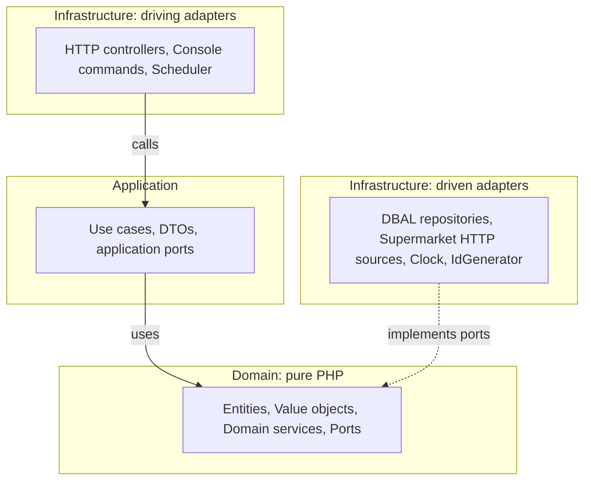
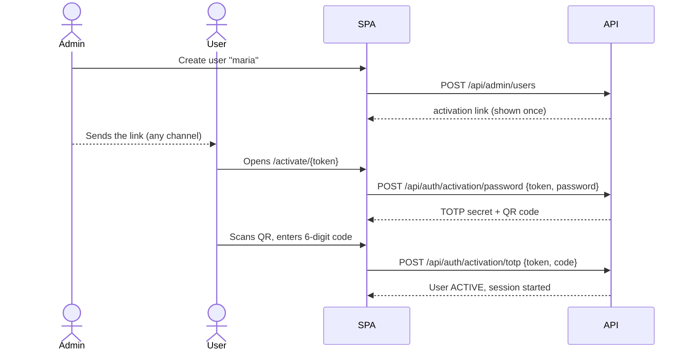
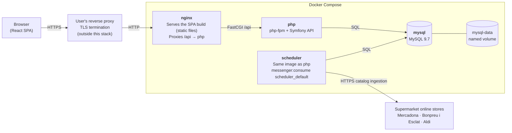

# Architecture

This document is the technical source of truth. If the code and this document disagree, raise it as a question. Do not silently pick one.

## Contents

1. [Product decisions](#product-decisions)
2. [Stack](#stack)
3. [Architecture style](#architecture-style)
4. [Bounded contexts](#bounded-contexts)
5. [Domain model](#domain-model)
6. [Backend structure](#backend-structure)
7. [Frontend structure](#frontend-structure)
8. [Key flows](#key-flows)
9. [HTTP API (draft)](#http-api-draft)
10. [Persistence](#persistence)
11. [Testing strategy](#testing-strategy)
12. [Runtime and deployment](#runtime-and-deployment)
13. [Open questions](#open-questions)

---

## Product decisions

Decisions confirmed by the product owner. Changing any of them requires asking first.

| ID | Decision |
| --- | --- |
| PD-1 | MVP supermarkets: **Mercadona, Bonpreu i Esclat, Aldi**. Each chain is a separate adapter; more chains come later. |
| PD-2 | **User accounts with login.** A shopping list has an **owner** and **members**. It is shared through a **secret link** (unguessable token). Opening the link **requires being logged in** and makes the user a member, so the list appears in their "My lists". The owner sees the members, can remove them and can **regenerate the link** (the old one stops working). *(Supersedes the original "no accounts" decision.)* |
| PD-3 | Comparison is **search + unit price**: a search returns products from every chain, ranked by price per kg / L / unit. There is **no cross-chain product matching** (no EAN grouping). |
| PD-4 | A list item is either **free text** ("leche") or a **concrete product** of a supermarket. Product items show price and contribute to an **estimated total per supermarket**. |
| PD-5 | **One postal code per instance**, set in `.env`. Ingestion fetches prices for that location only. |
| PD-6 | **Price history is stored**: each ingestion run writes dated price snapshots. |
| PD-7 | Collaboration uses **polling** (~5 s) while a list is open. No WebSockets or Mercure. |
| PD-8 | UI language is **Spanish**, with all copy in translation files (i18n ready). Code, comments and technical docs are **English**. |
| PD-9 | The instance is **closed**: the whole app (search included) requires login. There is no self sign-up. *(Supersedes the original "open instance" decision.)* |
| PD-10 | It is a **web app** (SPA). No native mobile app for now. |
| PD-11 | Environment files: the **backend follows the Symfony convention**. `backend/.env` (and `.env.test`) is committed with non-secret defaults. Real values and secrets go in `backend/.env.local`, which is ignored. The **root `.env`** used by Docker Compose is ignored, and a committed `.env.example` documents it. |
| PD-12 | **Users are created by an admin** of the platform. Users log in with a **username** (no email is stored or sent). Creating a user generates a **one-time activation link** that expires. The admin passes it to the user by any channel, and the user sets their password through it on first access. |
| PD-13 | **TOTP two-factor authentication is mandatory for every user.** It is configured on first access, right after setting the password, and nobody can use the app without it. |
| PD-14 | Roles: `ADMIN` (manages users and can also use the app) and `USER`. **First admin (setup):** while the platform has **no users**, the SPA redirects to `/setup`. Using it requires a **one-time setup code** that the backend prints in the container logs at startup, so whoever reaches the URL first cannot take over the instance. After entering the code and a username, the normal activation flow follows (password + TOTP). Once a user exists, `/setup` and its endpoints answer `404` forever. |
| PD-15 | Admin areas are **hidden in the frontend** for non-admins: no links, menu entries or buttons are rendered. If a non-admin still reaches an admin route or endpoint, the API answers `404` and the SPA shows the not-found page. The real protection is the backend; hiding is UX only. |
| PD-16 | Backend runtime: **PHP 8.5** and **MySQL 9.7 LTS** (newest stable PHP branch and newest MySQL LTS when E0 started). *(Supersedes the original PHP 8.4 and MySQL 8.4 LTS choice.)* |
| PD-17 | `GET /api/health` is **public**. It answers `200 {"status":"ok"}` when the database answers, and `503 {"status":"unavailable"}` when it does not. No internal details are exposed. |
| PD-18 | API errors map a small **domain error hierarchy** in `Shared\Domain\Exception` to HTTP: `NotFound` → `404`, `InvalidArgument` → `422`, `Conflict` → `409`. Symfony HTTP errors keep their status (unknown route `404`, wrong method `405`). Any other exception is a `500` with a generic title and **no internal details**, in every environment. Only domain errors include their message as `detail`. |
| PD-19 | `Money` is **never negative**: amounts and multipliers below zero are rejected. A signed amount (price differences, discounts) needs its own decision. |
| PD-20 | Each supermarket has its own color token, **inspired by its brand** so the chain is recognisable at a glance: Mercadona green, Bonpreu i Esclat orange, Aldi navy. The rest of the UI uses a neutral palette with one primary color. |
| PD-21 | The unit price (price ÷ normalized quantity) is rounded to whole cents **half-up**: 2.6533 €/L → 2.65 €/L, 2.655 €/L → 2.66 €/L. It is computed with integers only. |
| PD-22 | Products that disappear from their supermarket's catalog are marked **unavailable**. Search returns **only available products**. A shopping list that already contains one keeps showing it, flagged as unavailable and **not counted in the totals**. It becomes available again when its supermarket returns it. *(Answers OQ-6.)* |
| PD-23 | During ingestion, a **malformed product** (blank name, negative price, invalid image URL…) is **skipped**: it is not imported, a warning is logged and it is counted in the run (`products_skipped`). The rest of the catalog is imported. |
| PD-24 | Which supermarkets are enabled is decided **only by `ENABLED_SUPERMARKETS`** in `.env` (comma-separated slugs). The `supermarket` table stores id and name only, with no `enabled` column. |
| PD-25 | Products not seen in a run are marked unavailable **only when the run succeeds**. A run that fails half-way or returns **zero products** is recorded as **failed**: what it imported before failing is kept (with its snapshots), and every other product keeps its previous state. |
| PD-26 | Requests to supermarkets identify the project (except Bonpreu i Esclat, PD-32): User-Agent `jolo-market/1.0 (+https://github.com/joeljoanlopez/jolo-market)` by default, overridable per instance with `CATALOG_HTTP_USER_AGENT` (operators may add their own contact). |
| PD-27 | Catalogs are ingested **daily at 05:00 Europe/Madrid** by default. `INGESTION_SCHEDULE` (cron expression, evaluated in Europe/Madrid) changes it per instance. *(Answers OQ-1.)* |
| PD-28 | **Mercadona** is ingested from the internal JSON API of `tienda.mercadona.es`, accepted for **private, self-hosted use** (one instance, one run a day, identifying User-Agent) even though its `robots.txt` disallows `/api`. The operator takes that risk. *(Partly answers OQ-5.)* |
| PD-29 | When a product's size is **approximate** (loose fruit and vegetables) and the source gives its own price per kg, L or unit, that **reference price is the unit price**. Otherwise the unit price is always computed by us. Adapters pass a reference price only for approximate sizes. |
| PD-30 | *(Replaced by PD-31 for Aldi and PD-32 for Bonpreu i Esclat.)* The Bonpreu i Esclat and Aldi adapters were deferred: Bonpreu's WAF blocks an identifying User-Agent and Aldi seemed to publish no food prices. |
| PD-31 | **Aldi** is ingested from the public category pages of `www.aldi.es` (allowed by its `robots.txt`), which embed their products and prices in `__NEXT_DATA__`. Prices are the **peninsula** ones (`/can/` and `/bal/` are disallowed), and they are used for every postal code, Baleares and Canarias included, so the postal code is not used. Canned food is sized by its **drained weight** (`peso esc.`), the only size Aldi gives. Products without a published price (mostly loose fresh produce) are stored without one. Aldi is in the default `ENABLED_SUPERMARKETS`. *(Replaces the Aldi part of PD-30, whose spike sample was wrong: on 2026-11-09, 2 480 of 2 666 products had a price. Peninsula prices for every postal code and drained weight as the size confirmed by the product owner on 2026-11-09.)* |
| PD-32 | **Bonpreu i Esclat** is ingested from the internal JSON API of `www.compraonline.bonpreuesclat.cat` (Ocado Smart Platform), with a **browser User-Agent**: its WAF rejects any other client. This overrides PD-26 for Bonpreu only, and like PD-28 it is accepted for **private, self-hosted use** even though `robots.txt` disallows `/api/`. The operator takes that risk. The WAF challenges the seventh API request within about five minutes, and only a browser running its JavaScript can pass a challenge, so the adapter **waits 90 seconds between API requests** instead of trying to pass it, and after a challenge waits six minutes and retries, up to twice (a run takes about an hour and a half). The online store has one price region (Catalunya): every postal code gets the same price, so the postal code is not used. Bonpreu is in the default `ENABLED_SUPERMARKETS`. *(Replaces the Bonpreu part of PD-30; with PD-28 and PD-31, OQ-5 is closed. One price for every postal code confirmed by the product owner on 2026-11-09.)* |
| PD-33 | Search has **one filter in the MVP: supermarket** (brand and category later). Results are **grouped by unit price unit** (kg, L, unit): the unit with the most results for the query comes first, and each group is ordered by unit price ascending. Products without a unit price go last. Ties on unit price are broken by the **lower shelf price**, then name, then id, so pages are stable. The cheapest unit price is highlighted **within each unit group**. Units with as many results go in the order kg, L, unit. Every query word must match the **start of a word** in the name or brand, short words ("de", "xl") included, so search works while a word is still being typed. *(Answers OQ-7.)* |
| PD-34 | An **activation link is valid for 72 hours**. While a user is still pending activation, an admin can **regenerate** their link: the new link gets a fresh 72 hours and the previous one stops working at once. *(Answers OQ-8, confirmed by the product owner on 2026-11-09.)* |
| PD-35 | **Lost password or lost 2FA device: an admin resets the user.** The user goes back to pending activation, their password and TOTP secret are removed, their sessions stop working, and a new activation link (PD-34) is generated so they set a new password and enroll a new TOTP device. Their lists and memberships are kept. There are **no TOTP recovery codes** in the MVP. For a locked-out admin, the server operator runs the console command `app:user:reset <username>`, which does the same and prints the new link. *(Answers OQ-9, confirmed by the product owner on 2026-11-09.)* |
| PD-36 | **Admin user management beyond creation: disable/enable and change role, no delete.** A disabled user cannot log in and their sessions stop working; their lists and memberships are kept and other members still see them. Enabling returns the user to active. An admin can change a role between `USER` and `ADMIN`. The **last active admin** cannot be disabled or lose the `ADMIN` role, and an admin cannot disable themselves. Users cannot be deleted in the MVP. *(Answers OQ-10, confirmed by the product owner on 2026-11-09.)* |
| PD-37 | **Password policy:** at least **12 characters** (at most 128), with at least one **uppercase letter**, one **lowercase letter**, one **digit** and one **special character** (any character that is not a letter or a digit). There is no breached-password check. **Session:** expires after **7 days of inactivity**, renewed on each request (sliding expiry); there is no "remember me". Every login asks for the TOTP code (PD-13). *(Answers OQ-11, confirmed by the product owner on 2026-11-09.)* |
| PD-38 | **Self-service profile page.** A logged-in user can **change their password** (asks for the current password and a TOTP code; the new one follows PD-37) and **re-enroll TOTP** (asks for the current password and a code from the current device, then shows a new QR code and manual secret, and the new device is active only after a code from it is confirmed; until then the old device keeps working). Both actions **end every other session** of the user and keep the current one. *(Answers OQ-12, confirmed by the product owner on 2026-11-09.)* |
| PD-39 | A **username** has 3 to 32 characters: lowercase letters `a`–`z`, digits, `.`, `_` and `-`, starting with a letter or a digit. It is case-insensitive and stored in lowercase (`Maria` is `maria`). Accents, `ñ` and spaces are not allowed. *(Confirmed by the product owner on 2026-11-09.)* |
| PD-40 | **Renewing the session cookie keeps the session id.** Once an hour (and on the first request after an activation) the API re-sends the session cookie with 7 more days, with the **same id**. Changing the id there would destroy the old one, and a request the browser sent at the same moment would get a `401` and log the user out. The id still changes on every login (session fixation), and logout still ends the session on the server. *(Bug found while protecting the catalog in E3.21; fix confirmed by the product owner on 2026-11-10.)* |
| PD-41 | **The TOTP QR code is drawn in the browser** with the npm package `qrcode` (pinned), from the `provisioningUri` the API already returns. The API contract does not change and the secret never leaves the user's browser. *(Confirmed by the product owner on 2026-11-10.)* |
| PD-42 | **Admin actions that remove access ask first.** On the users page, "Resetear" (removes password and TOTP, ends sessions) and "Desactivar" (ends sessions) turn into an inline "¿…? Confirmar / Cancelar" in the user's row. Regenerating a link, enabling and changing the role apply at once. An admin is not offered to reset or disable their own account. *(Confirmed by the product owner on 2026-11-10.)* |
| PD-43 | **Concurrent list edits: last write wins, per operation.** Operations state the intent (check sets `checked = true`, it never toggles), so two people checking the same item agree. Two edits of the same field keep the last one; edits to different items or fields never undo each other, because saving a list checks the `version` it was loaded with and the API retries the operation on a fresh copy when someone else saved first. The user never sees a conflict error. *(Answers OQ-3, confirmed by the product owner on 2026-11-11.)* |
| PD-44 | **The owner can delete a list; a member can leave it; ownership cannot be transferred.** Deleting asks for confirmation and removes the list for everyone: it disappears from every "My lists" and anyone who has it open sees "list not found" (`404`). A member can leave on their own and can join again later through the link while it is valid. The owner cannot leave their own list, only delete it. *(Answers OQ-4, confirmed by the product owner on 2026-11-11.)* |
| PD-45 | **List details.** A list name is required, 1 to 80 characters after trimming. A free-text item has 1 to 120 characters after trimming. A quantity is a whole number from 1 to 99, 1 by default. Adding a product that is already in the list and unchecked adds the quantity to that item instead of creating another one (above 99 → `422`). New items go to the end; the list shows unchecked items first, in their order, then checked ones. The total per supermarket adds `price × quantity` of every **available** product item, checked or not (the estimated cost of the whole list). A removed member can join again while the link is valid (the owner regenerates it to stop that). *(Confirmed by the product owner on 2026-11-11.)* |
| PD-46 | **Price history retention: 24 months.** Snapshots older than `PRICE_HISTORY_RETENTION_MONTHS` (default `24`) are deleted by `app:catalog:prune-history`, which the scheduler runs daily at `PRICE_HISTORY_PRUNE_SCHEDULE` (cron in Europe/Madrid, default `30 4 * * *`, before the ingestion) and the operator can also run by hand. The **latest snapshot of each product is always kept**, however old, so an unavailable product still shows its last known price. *(Answers OQ-2, confirmed by the product owner on 2026-11-12.)* |
| PD-47 | **Price history range.** `GET /api/products/{id}/price-history` takes optional `from` and `to` dates (`YYYY-MM-DD`), both **inclusive** and read as days in **Europe/Madrid**. Without them it returns the whole history. A malformed date or `from` after `to` is a `422`; an unknown product a `404`. *(Confirmed by the product owner on 2026-11-12.)* |
| PD-48 | **Product detail page** `/product/:id`: image, name, brand, supermarket, packaging, price, an "unavailable" flag, "Añadir a una lista" (available products only) and the price history. The chart shows the **shelf price**. A range selector offers "30 días", "6 meses" (default), "1 año" and "Todo"; minimum and maximum are those of the selected range, and "current" is the product's current price. With no snapshot in the range it says so (no minimum or maximum); one snapshot is drawn as a single point. The time axis goes from the first to the last snapshot of the range. The **product name** links to this page from search results and from the product items of a list (not for a product the catalog no longer knows). *(Confirmed by the product owner on 2026-11-12.)* |
| PD-49 | **The price chart is our own SVG component** (`PriceHistoryChart`), with no chart library: a step line of the price over time, colored with theme tokens and testable in jsdom. *(E5.5, confirmed by the product owner on 2026-11-12.)* |

## Stack

| Concern | Choice | Why |
| --- | --- | --- |
| Language (BE) | PHP 8.5 | Required stack. Readonly classes, enums and property hooks fit value objects well. Newest stable branch (PD-16). |
| Framework (BE) | **Symfony 7.4 LTS** | Long-term support. Its DI container and components (Console, Scheduler, HttpClient, Messenger) can stay strictly in the infrastructure layer. It is less intrusive than Laravel for hexagonal design: no Active Record and no facades. |
| Persistence | **Doctrine DBAL** + Doctrine Migrations | Explicit SQL in infrastructure repositories keeps domain classes free of ORM metadata. Bulk inserts for price snapshots are simple and fast. |
| Database | **MySQL 9.7 LTS** | Required stack (PD-16). `utf8mb4_0900_ai_ci` gives accent- and case-insensitive search. FULLTEXT indexes cover product search. |
| HTTP client | Symfony HttpClient | Used only inside supermarket adapters. Supports retries and mock responses for tests. |
| Scheduling | Symfony Scheduler + Console command | Ingestion runs as a console command, triggered by a scheduler worker container. |
| Logging | Monolog (`symfony/monolog-bundle`) | Standard Symfony logging. Structured context, JSON to stderr in production so the container runtime collects it. Used only in Infrastructure, behind application ports. |
| Authentication | Symfony Security (session cookie) + `scheb/2fa-bundle` with `scheb/2fa-totp` + Symfony RateLimiter | The SPA and the API share the same origin (nginx), so an `HttpOnly`, `Secure`, `SameSite=Lax` session cookie is simpler and safer than JWT in browser storage. `scheb/2fa` is the standard Symfony TOTP integration. Login and 2FA attempts are rate-limited. Passwords are hashed with Symfony's `auto` hasher (bcrypt/argon2id). All of this lives in Infrastructure; the Identity domain is framework-free. |
| Language (FE) | TypeScript (strict) | Required stack. |
| Framework (FE) | **React + Vite** | Mature ecosystem. Fits atomic design and the container/presentational pattern. Vite gives fast dev builds and a static output that nginx serves. |
| Server state (FE) | TanStack Query | Caching, background refetch and **polling** (`refetchInterval`) out of the box, which covers PD-7. |
| Routing (FE) | React Router | Covers `/setup`, `/login`, `/activate/:token`, `/`, `/search`, `/lists/:id`, `/join/:token`, `/admin/users`, with route guards for authenticated and admin areas. |
| i18n (FE) | react-i18next | Covers PD-8. |
| Styling (FE) | **Tailwind CSS** (Vite plugin) + `class-variance-authority` + `tailwind-merge` | Design tokens (colors, spacing, typography, radii) are defined once in the Tailwind theme. Only values from that scale are used, which keeps the UI consistent. Component variants are declared in one place with `cva`. Class conflicts are resolved with `tailwind-merge`. No runtime CSS-in-JS. |
| BE quality | PHPUnit, PHPStan (max), **Deptrac** (layer rules), PHP-CS-Fixer, Infection (mutation testing, optional gate) | Deptrac enforces the hexagonal dependency rule in CI. |
| FE quality | Vitest, Testing Library, MSW, Playwright, ESLint, Prettier, `tsc --noEmit` | |
| Runtime | Docker Compose: `nginx`, `php` (fpm), `scheduler`, `mysql` | Single-host self-hosting. |

### Pinned versions

Pinned in [E0](epics/E0-foundation.md) to the latest stable patch, checked on 2026-11-06 against the official sources. Bump them deliberately, one at a time, with the full `composer check` passing.

| Component | Version | Pinned in | Source |
| --- | --- | --- | --- |
| PHP (fpm, Alpine image) | 8.5.12 | `docker/php/Dockerfile`, `config.platform` in `backend/composer.json` | [php.net](https://www.php.net/supported-versions.php) |
| Symfony | 7.4 LTS (7.4.23 at pin time) | `extra.symfony.require: 7.4.*` in `backend/composer.json`; exact patch in `composer.lock` | [symfony.com/releases](https://symfony.com/releases) |
| MySQL | 9.7.4 LTS | `compose.yaml`, `server_version` in `backend/config/packages/doctrine.yaml` | [dev.mysql.com](https://dev.mysql.com/doc/relnotes/mysql/9.7/en/) |
| nginx | 1.30.6 (stable) | `compose.yaml` | [nginx.org](https://nginx.org/en/download.html) |
| Composer | 2.11.1 | `docker/php/Dockerfile` | [getcomposer.org](https://getcomposer.org/download/) |
| Xdebug (optional) | 3.5.3 | `docker/php/Dockerfile` | [pecl.php.net](https://pecl.php.net/package/xdebug) |

| Node.js | 26.13.0 LTS ("Lithium") | `frontend/.nvmrc`, `engines` in `frontend/package.json` | [nodejs.org](https://nodejs.org/en/about/previous-releases) |
| React | 19.3.1 | `frontend/package.json` (exact) | [npm](https://www.npmjs.com/package/react) |
| Vite | 8.3.6 | `frontend/package.json` (exact) | [npm](https://www.npmjs.com/package/vite) |
| TypeScript | 6.0.3 | `frontend/package.json` (exact) | [npm](https://www.npmjs.com/package/typescript) |

Backend libraries (PHPUnit, PHPStan, PHP-CS-Fixer, Deptrac, Doctrine) are locked in `backend/composer.lock`. Every frontend dependency is pinned to an exact version in `frontend/package.json` and locked in `frontend/package-lock.json`.

TypeScript stays on **6.0** on purpose: TypeScript 7 (7.0.2 at pin time) is not yet supported by `typescript-eslint` (it requires `<6.1`). Move to 7 when `typescript-eslint` supports it.

## Architecture style

**Hexagonal architecture (ports and adapters)** combined with **screaming architecture**: top-level folders are named after business capabilities, not technical layers.



Solid arrows are calls, and dashed arrows are interface implementations. Every dependency points **inwards**: Domain knows nothing about the other boxes.

### Dependency rules (enforced by Deptrac)

| Layer | May depend on | Must never depend on |
| --- | --- | --- |
| `Domain` | `Shared\Domain` only | Application, Infrastructure, Symfony, Doctrine, any vendor |
| `Application` | Domain, `Shared\Domain`, `Shared\Application` | Infrastructure, Symfony, Doctrine |
| `Infrastructure` | Everything above + vendor | — |
| Context A | Context B **only** through B's `Application` public API (query services) | B's Domain or Infrastructure |

Allowed cross-context paths today: ShoppingList Infrastructure → Catalog Application (`GetProductsHandler`) and Identity Application (`FindUsernamesHandler`).

### Rules of thumb

- **Ports** are interfaces owned by the inner layer (`Domain` for repositories and domain-facing collaborators, `Application` for application concerns such as a transaction manager).
- **Adapters** live in `Infrastructure` and implement ports.
- **Use cases** have one public method (`__invoke`), receive a command/query DTO and return a DTO or nothing. They never return entities to controllers.
- **Entities** protect their invariants. No public setters. They are created through named constructors.
- **Value objects** are immutable, `final readonly` and self-validating.
- **Money** is stored as integer cents. Floats are never used for money.
- **Time and IDs** come from ports (`Clock`, `IdGenerator`) so tests stay deterministic.
- **Controllers** only map HTTP ↔ DTOs and call a use case.

## Bounded contexts

| Context | Responsibility | Main aggregates |
| --- | --- | --- |
| **Catalog** | Supermarkets, their products, current prices, price history, ingestion from external sources, search and comparison. | `Supermarket`, `Product` |
| **Identity** | Users, roles, activation links, password, mandatory TOTP 2FA, login. | `User` |
| **ShoppingList** | Lists with owner and members, joining through the secret link, items (free text or product reference), checking items, per-supermarket totals. | `ShoppingList` |
| **Shared** | Shared kernel: `Money`, `Uuid`, `UserId`, `Clock`, base exceptions. Kept minimal. | — |

`ShoppingList` reads product data (name, price, supermarket) through a **Catalog query port** (`ProductCatalog` interface in ShoppingList's Application layer, implemented in Infrastructure by calling Catalog's application query service). It never imports Catalog domain classes.

`ShoppingList` only knows users by `UserId` (shared kernel). The current user reaches use cases as an explicit `actorId` in each command/query. Use cases never read Symfony's security token; the controller extracts the id and passes it in. Display names of members are read through a `UserDirectory` port implemented on top of Identity's application query service.

## Domain model

### Catalog

```text
Supermarket (aggregate root)
  id: SupermarketId            e.g. "mercadona", "bonpreu", "aldi" (stable slug)
  name: string                 enabled or not is configuration (PD-24), not state

Product (aggregate root)
  id: ProductId                internal UUID
  supermarketId: SupermarketId
  externalId: ExternalProductId  id in the supermarket's store (unique per supermarket)
  details: ProductDetails       name: ProductName, brand: ?string, category: ?CategoryPath, imageUrl: ?Url
  packaging: ?Packaging        quantity + unit (e.g. 1 L, 500 g, 6 units); null when unknown
  currentPrice: Money
  unitPrice: ?UnitPrice        Money per UnitOfMeasure (kg | L | unit), always derived from
                               currentPrice and packaging; null when packaging is unknown
  lastSeenAt: DateTimeImmutable
  available: bool              false when the last ingestion did not return it

PriceSnapshot (append-only, created by Product::captureSnapshot)
  productId, price: Money, unitPrice: ?UnitPrice, capturedAt
```

Value objects: `Money` (cents and currency, EUR only for now), `Packaging`, `UnitOfMeasure` (enum: `KILOGRAM`, `LITRE`, `UNIT`), `UnitPrice`, `ProductName`, `ExternalProductId`, `PostalCode`.

**Unit normalization:** grams → kg, ml/cl → L, and "pack of N" → unit. A source's own unit price is used only for approximate sizes (PD-29); otherwise ours is the only one. If packaging cannot be parsed, the product is stored **without** a unit price and ranked last. That is an explicit state, not a guess.

How it is modelled:

- `Packaging` stores the quantity as an **integer number of thousandths** of its `UnitOfMeasure` (500 g → 500 thousandths of a kg, 33 cl → 330 thousandths of a L, 12 units → 12 000), so no float is ever used. Named constructors (`kilograms`, `grams`, `litres`, `centilitres`, `millilitres`, `units`) take decimal strings with a dot. A quantity finer than a thousandth (for example `0.5 g`) is rejected, not rounded. `multipliedBy(n)` models multipacks (`6 x 33 cl`).
- `PackagingParser` (domain service) accepts only strings that match a known format completely: an optional `pack`/`pack de` prefix, an optional `N x` multiplier, a quantity with a comma or dot decimal, and a unit (`kg`, `g`/`gr`, `l`/`lt`/`litro(s)`, `cl`, `ml`, `u`/`ud`/`uds`/`unidad(es)`). Anything else (approximate weights such as `1,2 kg aprox.`, ranges, unknown words) returns `null`, the explicit "unknown" state. New formats are added to its table-driven test as each supermarket spike finds them.
- `UnitPriceCalculator` computes `price ÷ normalized quantity` rounded half-up to whole cents (PD-21).
- `PostalCode` accepts five digits whose first two are a Spanish province (`01`–`52`).

**Ports (Catalog Domain):**

- `ProductRepository`: `save` (insert or update), `findBySupermarketAndExternalId`, `findAvailableNotSeenSince(supermarketId, instant)` (the products a run did not see). Search is added in E2.
- `PriceSnapshotRepository`: `append(...snapshots)` in one batch; `deleteCapturedBefore(cutoff)` deletes older snapshots but never the latest of a product (PD-46). The history of a product is read through the application read model `PriceHistoryReadModel` (E5).
- `SupermarketCatalogSource`: `supermarketId()` and `fetchCatalog(PostalCode): iterable<SourceProduct>`. **One adapter per chain.** `SourceProduct` carries plain values (external id, name, price in cents, packaging text, brand, category segments, image URL and, for approximate sizes only, a reference unit price in cents with its unit `kg`/`l`/`unit`), so one malformed product does not stop a source from returning the rest of its catalog.

`Product` is created with `register` and changed only through `updateFromSource` (new details, price and packaging; makes it available again) and `markUnavailable`. `Supermarket` is created with `create(id, name)`; `SupermarketId` is a slug of lowercase letters, digits and inner hyphens.

### Identity

```text
User (aggregate root)
  id: UserId
  username: Username                  PD-39; unique, case-insensitive, normalized to lowercase
  role: Role                          ADMIN | USER
  status: UserStatus                  PENDING_ACTIVATION | ACTIVE | DISABLED
  passwordHash: ?PasswordHash         null until set (hashing is a port, never done in the domain)
  totpSecret: ?EncryptedTotpSecret    confirmed secret (encrypted at rest) + totpConfirmedAt; required before ACTIVE
  pendingTotpSecret: ?EncryptedTotpSecret  enrolled but not confirmed yet
  activation: ?ActivationToken        SHA-256 hash of the one-time token + expiresAt (72 h, PD-34); null once used
  createdAt, createdBy: ?UserId       createdBy is null for the first admin (PD-14)
```

Lifecycle: `PENDING_ACTIVATION` → (valid activation link → set password → scan the TOTP QR code → confirm a code) → `ACTIVE`. Only the **hash** of the activation token is stored. The plain token appears only once, in the link shown to the admin.

`User::createPending` is followed by `setInitialPassword`, `startTotpEnrollment` (starting again replaces the unconfirmed secret) and `confirmTotp`. Each step checks the activation link again, so an expired link cannot finish an activation already started; an unknown, expired or used link is an `ActivationLinkNotValid` (404), and a step out of order is an `ActivationStepOutOfOrder` (409). Checking the TOTP code needs the decrypted secret, so the application layer does it through the ports before `confirmTotp`.

Value objects: `Username` (PD-39), `PlainPassword` (a new password, checked against PD-37; its errors never include the password), `TotpCode` (six digits, spaces ignored), `ActivationToken`, `PasswordHash`, `EncryptedTotpSecret`.

Ports (`Identity\Domain\Port`): `UserRepository` (`save`, `findById`, `findByUsername`, `findByIds`, `findAll` ordered by username, `findByActivationTokenHash`, `countActiveAdmins`, `hasAnyUser`), `PasswordHasher` (`hash(PlainPassword)`, `verify(hash, typed text)`), `TotpService` (`generateSecret`, `provisioningUri`, `verify(secret, code, now)`), `SecretEncrypter` (`encrypt`, `decrypt`) and `ActivationTokenGenerator` (`generate(): string`).

Use cases (`Identity\Application`). Admin use cases first check the actor through `AdminActor`: anyone but an active admin gets `AdminRequired` (404, PD-15).

- `CreateUserHandler` (admin): username + role → user pending activation; returns the **plain activation token once** with its expiry. A taken username (any case) is a `UsernameAlreadyTaken` (409).
- `ValidateActivationTokenHandler`: token → username and expiry of a valid link.
- `SetInitialPasswordHandler`: token + password (PD-37) → stores the hash and starts the TOTP enrollment; returns the secret and the `otpauth://` provisioning URI. Calling it again gives a new secret.
- `ConfirmTotpEnrollmentHandler`: token + code → checks the code against the pending secret (`TotpCodeRejected`, 422, when wrong), activates the user and returns its id.
- `ListUsersHandler` (admin): every user, ordered by username, with role, status and the expiry of a pending activation link.
- `FindUsernamesHandler`: the query API other contexts use (E3.9): user ids → usernames; unknown or malformed ids are left out.
- `RegenerateActivationLinkHandler` (admin, PD-34): pending users only (`UserStateConflict`, 409, otherwise). The new link has a fresh 72 h and drops a half-finished activation.
- `ResetUserHandler` (admin, PD-35): back to pending activation, credentials removed, sessions ended; returns the new link. Not on oneself (`CannotManageYourself`, 409) and not on a disabled user (enable first). `ResetUserByUsernameHandler` does the same for the server operator, without an actor (console only).
- `DisableUserHandler`, `EnableUserHandler`, `ChangeUserRoleHandler` (admin, PD-36): only an active user can be disabled and only a disabled one enabled. Disabling ends the user's sessions. Disabling or demoting the last active admin is a `LastActiveAdmin` (409); an admin cannot disable themselves.
- `ChangePasswordHandler`, `StartTotpReEnrollmentHandler`, `ConfirmTotpReEnrollmentHandler` (the user themselves, PD-38): changing the password and starting a re-enrollment ask for the current password and a code (`CredentialsRejected`, 422, the same for both). The old device works until a code from the new one is confirmed. Both changes return the new session version.

**Ending sessions.** `User` has a `sessionVersion` (starting at 1) that a reset, disabling, a new password or a new TOTP device increases. A session stores the version it started with and stops working when it no longer matches; the session that changed its own password or device moves to the new version and stays logged in.

**Ports (Identity):** `UserRepository`, `PasswordHasher`, `TotpService` (generate secret, verify code), `ActivationTokenGenerator`, `SecretEncrypter`.

### ShoppingList

```text
ShoppingList (aggregate root)
  id: ShoppingListId           internal UUID
  ownerId: UserId
  members: Member[]            userId + joinedAt of users who joined through the link (owner excluded), in join order
  shareToken: ShareToken       base64url, 22–64 characters (≥128 bits); the "secret link" used only to JOIN
  name: ListName               1–80 characters after trimming (PD-45)
  items: ListItem[]            in position order; an item's position is its index
  createdAt, updatedAt
  version: int                 moves on every real change (ETag, optimistic lock); loadedVersion is the one it was loaded with (0 = new)

ListItem (entity inside the aggregate)
  id: ListItemId
  content: FreeTextItem(ItemText, 1–120 characters) | ProductItem(ProductId)
  quantity: Quantity           whole number 1–99, 1 by default (PD-45)
  checked: bool
```

`ProductItem` keeps only the product id: name, price and supermarket are always read fresh from the catalog.

**Access rules:** owner and members can read and edit items. Only the owner can rename the list, remove members, regenerate the share token and delete the list (PD-44). A member can leave; the owner cannot (`OwnerCannotLeave`, 409). Anyone else, and a member trying an owner-only action, gets `ShoppingListNotFound` (404, PD-15). Joining with a valid token is idempotent, joining your own list is a no-op, and a removed member can join again. Operations state their intent (PD-43): `check`/`uncheck` set the flag, and a call that changes nothing does not move the version. `moveItem` takes a 0-based position; a position past the end moves the item last, a negative one is `InvalidItemPosition` (422).

**Ports (ShoppingList Domain):** `ShoppingListRepository` (`save` with the version check, throwing `ShoppingListChangedConcurrently`; `remove`; `findById`; `findByShareToken`; `findByUser`, owned or joined) and `ShareTokenGenerator`. **Ports (ShoppingList Application):** `ProductCatalog` (`findByIds` → `CatalogProduct`, available or not) and `UserDirectory` (`usernamesOf`).

**Use cases** (`ShoppingList\Application`), each with an explicit `actorId`: `CreateList`, `JoinList`, `ManageList/{RenameList, RegenerateShareToken, RemoveMember, LeaveList, DeleteList}`, `EditItems/{AddItem, UpdateItem, RemoveItem, ClearCheckedItems}`, and the queries `GetList` and `GetMyLists`. Changing use cases go through `ListUpdater`: load, apply the operation, save; when someone else saved first it runs the whole operation again on a fresh copy, up to 5 attempts (PD-43). Adding a product checks through `ProductCatalog` that it exists and is available (`ProductNotAvailable`, 422).

**Totals:** the estimated total per supermarket is the sum of `price × quantity` of the **available** product items of that supermarket, checked or not (PD-45); unavailable products are flagged and left out (PD-22). Free-text items are listed but not priced. It is computed in `GetList` with a fresh price from the `ProductCatalog` port.

**Adapters (ShoppingList Infrastructure):** `DbalShoppingListRepository` (`UPDATE … WHERE version = :loaded`, then members and items rewritten in the same transaction), `RandomShareTokenGenerator` (`random_bytes(32)`, base64url, 43 characters), `CatalogProductCatalog` on Catalog's `GetProductsHandler` (ids → `ProductView`s, one lookup per product) and `IdentityUserDirectory` on Identity's `FindUsernamesHandler`. Controllers take the actor id from the session user's identifier (`UserInterface::getUserIdentifier()`), so they do not depend on Identity's infrastructure.

## Backend structure

```text
backend/
├── src/
│   ├── Catalog/
│   │   ├── Domain/
│   │   │   ├── Model/           # Supermarket, Product, PriceSnapshot
│   │   │   ├── ValueObject/     # Packaging, UnitPrice, UnitOfMeasure...
│   │   │   ├── Port/            # ProductRepository, SupermarketCatalogSource...
│   │   │   ├── Service/         # UnitPriceCalculator (pure)
│   │   │   └── Exception/
│   │   ├── Application/
│   │   │   ├── IngestCatalog/   # IngestCatalogCommand + IngestCatalogHandler
│   │   │   ├── SearchProducts/  # SearchProductsQuery + handler + result DTO
│   │   │   ├── GetProduct/      # GetProductQuery + handler + ProductView; GetProductsHandler (query API for lists)
│   │   │   ├── ListSupermarkets/ # ListSupermarketsQuery + handler
│   │   │   ├── PrunePriceHistory/ # PrunePriceHistoryCommand + handler (PD-46)
│   │   │   └── GetPriceHistory/ # GetPriceHistoryQuery (PriceHistoryRange, PD-47) + handler + PriceHistory DTO
│   │   └── Infrastructure/
│   │       ├── Persistence/Dbal/
│   │       ├── Source/Mercadona/
│   │       ├── Source/BonpreuEsclat/
│   │       ├── Source/Aldi/
│   │       ├── Api/             # controllers
│   │       ├── Http/            # HTTP client of the supermarket sources
│   │       ├── Scheduler/       # CatalogSchedule: ingestion and price history prune
│   │       └── Console/         # app:catalog:ingest, app:catalog:prune-history
│   ├── Identity/
│   │   ├── Domain/ Application/ Infrastructure/   # same layout; Symfony Security + scheb/2fa adapters live in Infrastructure/Security
│   ├── ShoppingList/
│   │   ├── Domain/ Application/ Infrastructure/   # same layout
│   └── Shared/
│       ├── Domain/              # Clock port, ValueObject/ (Money, Currency, Uuid), Exception/ (PD-18)
│       ├── Application/
│       └── Infrastructure/      # SystemClock, RandomTokenGenerator, Symfony kernel glue
├── tests/
│   ├── Unit/                    # Domain + Application, in-memory fakes, no I/O
│   ├── Integration/             # DBAL repos vs real MySQL, adapters vs recorded fixtures
│   ├── Functional/              # HTTP API through Symfony kernel
│   └── Fixtures/                # recorded supermarket responses (JSON/HTML)
├── migrations/
├── config/
└── deptrac.yaml
```

Test folders mirror `src/` (for example, `tests/Unit/Catalog/Domain/ValueObject/PackagingTest.php`). Reusable test doubles of shared ports live in `tests/Support/` (for example `FixedClock`).

### Shared kernel

| Class | Notes |
| --- | --- |
| `Shared\Domain\ValueObject\Money` | Integer cents, `Currency::EUR` only. `eur()`, `add()`, `multiply(int)`, `equals()`, `compareTo()`, `isGreaterThan()`, `isLessThan()`. Never negative (PD-19). |
| `Shared\Domain\ValueObject\Uuid` | Canonical `8-4-4-4-12` hex string, normalized to lowercase. It only validates; generation belongs to an `IdGenerator` port. |
| `Shared\Domain\ValueObject\UserId` | Wraps a `Uuid`. Other contexts know users only by this id. |
| `Shared\Domain\Clock` | Port returning the current `DateTimeImmutable`. `Shared\Infrastructure\Clock\SystemClock` implements it in **UTC**; tests use `Tests\Support\FixedClock`. |
| `Shared\Domain\IdGenerator` | Port returning a new `Uuid`. `Shared\Infrastructure\Id\UuidV7Generator` implements it with time-ordered UUIDv7 (`symfony/uid`); tests use `Tests\Support\SequentialIdGenerator`. |

## Frontend structure

Feature-first (screaming) folders. Each feature has a light hexagonal split. Shared UI follows **atomic design**, and screens follow **container/presentational**.

```text
frontend/src/
├── features/
│   ├── catalog/
│   │   ├── domain/          # types + pure functions (formatUnitPrice, isCheapest)
│   │   ├── application/     # hooks/use cases (useProductSearch) depending on ports
│   │   ├── infrastructure/  # API client implementing the port (fetch), DTO mappers
│   │   └── ui/
│   │       ├── containers/  # SearchPageContainer: wires hooks → presentational
│   │       └── components/  # ProductResultList, PriceTag... (props only, no fetching)
│   ├── auth/                # login, activation, 2FA setup, session (current user)
│   ├── admin/               # user management
│   └── shopping-list/       # same layout
├── shared/
│   ├── ui/                  # atoms/ molecules/ organisms/ templates/
│   ├── i18n/                # react-i18next setup + locales/es.json
│   └── http/                # base fetch wrapper, error mapping, 401 → login redirect
├── app/                     # router (with auth/admin guards), providers, layout
└── main.tsx
```

Rules:

- The `@/` import alias points to `src/`.
- Boundaries inside a feature are enforced by ESLint (`no-restricted-imports` in `frontend/eslint.config.js`): `domain/` cannot import React, `application/`, `infrastructure/` or `ui/`; `application/` cannot import `infrastructure/` or `ui/`.
- i18n: `createI18n()` in `shared/i18n` loads `locales/es.json`. In tests, any key rendered without a translation fails the test (`src/test/setup.ts`).
- Test helpers live in `src/test/`: `renderWithProviders`, the MSW `server` (unhandled requests fail the test) and the test i18n instance.
- Presentational components get data through props, render it, and emit events. They never fetch.
- Containers hold state and data access. They contain no styling logic and no Tailwind classes beyond layout.
- Styling uses Tailwind utilities **with theme tokens only**. Arbitrary values (`w-[13px]`, `text-[#3a3a3a]`) are not allowed. If a value is missing, add it to the theme.
- Repeated class combinations become an atom or molecule (with `cva` variants), never a copy-pasted string. `@apply` is avoided.
- Theme tokens live in `@theme` in `frontend/src/index.css`. Tailwind's default colors, font sizes, fonts and radii are **reset**, so only these tokens exist:
  - Colors: `background`, `surface`, `border`, `foreground`, `muted`, `primary` (+ `-hover`, `-foreground`), `danger` (+ `-hover`, `-foreground`), `focus`, and one per supermarket with a readable foreground: `mercadona`, `bonpreu`, `aldi` (+ `-foreground`) (PD-20).
  - Font sizes `xs`–`3xl`, font `sans`, radii `sm`, `md`, `lg`, `full`, and the spacing unit `--spacing: 0.25rem`.
  - A new token must also be added to `cn()` (`shared/ui/lib/cn.ts`) so `tailwind-merge` resolves conflicts correctly.
- `cn()` joins classes and lets the last conflicting utility win. Atoms (`shared/ui/atoms`): `Alert` (an error message with `role="alert"`), `QrCode` (an SVG QR code of `value`, dark on light with a 4-module quiet zone, from `qrcode`; PD-41), `Button` (`variant`: primary, secondary, danger; `size`: sm, md), `Input` (`invalid`), `Label`, `Select` (native, same look as `Input`), `Text` (`as`, `size`, `tone`: default, muted, danger; `weight`). Molecules (`shared/ui/molecules`): `FormField` (a labelled `Input` with an optional `hint` and `error`, both linked with `aria-describedby`; an error marks the input invalid), `SearchBox` (controlled `role="search"` form with a labelled search box; a submit button only when `onSubmit` is given; Enter never reloads) and `Pagination` (previous / next and a status text; the caller passes the copy). Shared components take their copy as props; feature components read it with `t()`.
- `prettier-plugin-tailwindcss` sorts classes, also inside `cva()` and `cn()`.
- HTTP: `createHttpClient({ baseUrl })` in `shared/http` wraps `fetch` (`get`, `post`, `put`, `patch`, `delete`). It sends same-origin cookies and JSON, adds `X-Requested-With: XMLHttpRequest` to every request that is not a `GET` (CSRF, E3.18), resolves with the parsed body as `unknown` (`undefined` when empty) and rejects with typed errors: `UnauthorizedError` (401), `NotFoundError` (404), `ConflictError` (409), `ValidationError` (422), `TooManyRequestsError` (429), `ServerError` (5xx), `HttpError` for any other status, and `NetworkError` when no response arrives. `getConditional(path, { etag })` sends `If-None-Match` and resolves with `{ notModified: true }` on a `304` or `{ notModified: false, body, etag }`; the list page polls with it (PD-7). Each error carries the parsed `problem` (falling back to the status when the body is not problem+json). Feature `infrastructure/` maps the `unknown` body to domain types; the UI picks Spanish copy from the error class, never from `problem.detail`.
- Unexpected API bodies: feature `infrastructure/` rejects a successful response whose body does not have the expected shape with `UnexpectedResponseError` (`shared/http/errors.ts`).
- Ports of a feature live in its `application/` and are injected with a React context (e.g. `ProductCatalogContext`), so hooks never import `infrastructure/` and tests pass an in-memory fake.
- Catalog feature (`features/catalog`):
  - `domain/`: types (`Product`, `ProductDetail`, `ProductSearchPage`, `Supermarket`, `Packaging`, `UnitPrice`, `Unit`, `CheapestUnitPriceCents`) and pure functions `formatPrice(cents)` (`1,25 €`), `formatUnitPrice(unitPrice, unitSymbols)` (`0,83 €/L`, `9,00 €/kg`, `0,30 €/ud`), `formatPackaging(packaging, unitSymbols)` (`1,5 L`, `0,5 kg`, `6 ud`) and `isCheapest(product, cheapestUnitPriceCents)` (lowest unit price of its unit over the whole query, PD-33). Formats use `Intl` with `es-ES`. The unit symbols (`kg`, `L`, `ud`) are UI copy: they live in `es.json` (`catalog.units`) and `ui/useUnitSymbols()` reads them for the formatters.
  - `application/`: port `ProductCatalog` (`searchProducts`, `getProduct`, `listSupermarkets`), `ProductCatalogContext` / `useProductCatalog()` (the app provides `createCatalogApi(createHttpClient({ baseUrl: window.location.origin }))` through `App`'s `productCatalog` prop), `useSupermarkets()` (enabled supermarkets for the filter; an empty list while loading or on failure, so the filter offers only "all"), and `useProductSearch({ text, supermarket?, page? })` on TanStack Query. The initial text is searched at once (landing on a search URL); later changes of the text wait 300 ms without typing (`SEARCH_DEBOUNCE_MS`); the filter and the page apply at once. A trimmed text shorter than 2 characters (`MIN_SEARCH_LENGTH`) does not query and is `idle` at once, without the debounce (clearing the box); a valid text still waiting for the debounce is `loading`. Pagination is page-based (`page` input, `keepPreviousData` keeps the previous page on screen while the next loads); the caller resets the page when the text or the filter changes. It returns `{ status: 'idle' | 'loading' | 'error' | 'success' }`, with `error` and `retry()` on error, and `data` and `isFetching` on success.
  - `infrastructure/`: `createCatalogApi(httpClient)` implements `ProductCatalog` over `GET /api/products`, `GET /api/products/{id}` and `GET /api/supermarkets`, validating every body into domain types.
  - `ui/components/`: `SupermarketBadge` (atom; the chain's theme colors, neutral for any other), `SupermarketFilter` (molecule; "Todos" + the enabled supermarkets), `PriceTag` (molecule; shelf price and unit price, `highlighted` variant with a "Más barato" label), `ProductCard` (organism; image or a placeholder, name, brand, badge, packaging, `PriceTag`) and `ProductResultList` (organism; a labelled list that highlights each product for which `isCheapest(product, cheapestUnitPriceCents)` holds, PD-33).
  - `ui/containers/SearchPageContainer` is the `/search?q=&supermarket=&page=` page. The URL is the source of truth: typing writes `q` with a history *replace* and drops `page`; choosing a supermarket ("Todos" removes the param) and changing page push a new entry, and the filter also drops `page`. The first page is never written as `page=1`. The search box keeps its text in local state (the URL commits a moment after each key press) and follows the URL on Back / Forward. States: idle (type at least 2 characters), loading, error (with retry), empty ("No hay resultados para «…»"), results (total, list, pagination; the previous page stays on screen with `aria-busy` while the next loads).
- Auth feature (`features/auth`):
  - `domain/`: `CurrentUser` (`id`, `username`, `role`), `Role` (`ADMIN`, `USER`), `isAdmin(user)`, `ActivationLink` (`username`, `expiresAt`), `TotpEnrollment` (`secret`, `provisioningUri`), `meetsPasswordPolicy(password)` (PD-37, the same rules as the API's `PlainPassword`, counting characters, not bytes) and `safeRedirectTarget(next)`: the page to open after login. Only a path of this app is accepted (never another site, a `//host` URL or the login page itself); anything else is `/`.
  - `application/`: port `AuthGateway`, injected with `AuthGatewayContext` (`App`'s `authGateway` prop): session (`getCurrentUser` → the user or `null`, `logIn`, `verifyLoginCode`, `logOut`), activation (`getActivationLink`, `setInitialPassword`, `confirmTotpEnrollment`), setup (`isSetupRequired`, `completeSetup`) and profile (`changePassword`, `startTotpReEnrollment`, `confirmTotpReEnrollment`). Hooks:
    - `useCurrentUser()` loads the session once: `loading`, `error` with `retry`, `anonymous` (with `loggedOut` when the user logged out on purpose) or `authenticated` with `user`. `useSetCurrentUser()` stores the user after a login or an activation. `useEndSessionOnUnauthorized()` watches every query and mutation: any `401` makes the session anonymous.
    - `useLogin()` runs the two login steps (`invalidCredentials`, `invalidCode`, `tooManyAttempts`, `failed`). `useLogout()` ends the session (a `401` counts as logged out; a network error keeps it and says so) and drops the cached data of that user.
    - `useActivation(token)`: `checking`, `checkFailed` (retry), `invalid` (a `404` at any step), `password`, `totp`, then `activated`, which also logs the user in.
    - `useSetupStatus(enabled)` asks `GET /api/setup` once, only for an anonymous visitor; a failed check lets the app carry on. `useCompleteSetup()` creates the first admin and returns their activation token.
    - `useChangePassword()` checks PD-37 before sending, so a `422` means a wrong current password or code. `useTotpReEnrollment()`: `proof` (password + current code), then `confirm` (the new device's code, or cancel); a `409` (nothing to confirm) starts over.
  - `infrastructure/`: `createAuthApi(httpClient)` over `/api/auth/*`, `/api/setup` and `/api/me/*` (a `401` on `/api/auth/me` is `null`; a `404` on `GET /api/setup` means not required).
  - `ui/containers/`:
    - `LoginPageContainer` (`/login?next=`): username and password, then the TOTP code ("Volver" goes back and clears the password). Once logged in, or when already logged in, it goes to `safeRedirectTarget(next)`.
    - `ActivationPageContainer` (`/activate/:token`): greets the user, asks for a password (with the policy as hint), shows the QR code and the manual secret, asks for a code, then opens `/`. An unknown, expired or used link shows "Este enlace no funciona".
    - `SetupPageContainer` (`/setup`): setup code + username of the first admin (PD-14), then their `/activate/:token`. Once users exist it goes to `/`.
    - `ProfilePageContainer` (`/profile`, PD-38): "Cambiar contraseña" (current password, current code, new password) and "Cambiar de app de autenticación" (proof, then the new device). Both say the other sessions ended.
    - `SessionMenuContainer`, in the app header: the username, "Mi perfil", "Usuarios" for an ADMIN only (PD-15) and "Cerrar sesión".
  - `ui/components/`: `LoginCredentialsForm`, `LoginCodeForm`, `NewPasswordForm`, `TotpEnrollmentForm` (QR code, manual secret, code; optional cancel), `SetupForm`, `ChangePasswordForm`, `TotpProofForm`, `SessionMenu`.
- Admin feature (`features/admin`, ADMIN only):
  - `domain/`: `AdminUser` (`id`, `username`, `role`, `status`: `PENDING_ACTIVATION` / `ACTIVE` / `DISABLED`, `createdAt`, `activationExpiresAt`), `ActivationLinkGrant` (a link shown once), `activationPath(grant)` and `formatDateTime(date)` (`13/11/2026, 10:05`, in the browser's time zone).
  - `application/`: port `UserAdministration` (`listUsers`, `createUser`, `regenerateActivationLink`, `resetUser`, `disableUser`, `enableUser`, `changeRole`), injected with `UserAdministrationContext` (`App`'s `userAdministration` prop). `useUsers()`, `useCreateUser()` (`taken` on 409, `invalid` on 422) and `useUserActions()` (one action at a time; a `409` is a rule of PD-34 to PD-36 and gets its own message). The list reloads after each change.
  - `infrastructure/`: `createAdminApi(httpClient)` over `/api/admin/users/*`.
  - `ui/`: `UsersPageContainer` is `/admin/users`: the create form, the users (`UserList`) with their role, status and link expiry, and per user the actions that apply (`UserActionButtons`, PD-42). A new link (create, regenerate or reset) appears once in `ActivationLinkPanel` as the full URL with "Copiar enlace", until "Hecho".
- Route guards (`app/guards`), from the outside in:
  - `RequireSetupDone` wraps `/login` and every page that needs a session. While a fresh instance has no users it sends everyone to `/setup` (PD-14). `/setup` and `/activate/:token` are outside it.
  - `RequireAuth` wraps every route except `/login`, `/setup` and `/activate/:token`. While the session loads it shows "Cargando…". An anonymous visitor goes to `/login?next=<path + query>` (just `/login` from `/` or after a logout), so a `/join/:token` link comes back after login. It also calls `useEndSessionOnUnauthorized()`, so a session that ends while the app is open sends the user to the login page.
  - `RequireAdmin` goes inside `RequireAuth` (around `/admin/users`) and renders the not-found page to a non-admin, never a "forbidden" message (PD-15).
- Home (`features/home`): the home page has a search box that opens `/search?q=…`, and below it "Mis listas" with the create-list form.
- Shopping-list feature (`features/shopping-list`):
  - `domain/`: `ShoppingList`, `ListItem` (text or product; a product the catalog no longer knows has `null` fields), `ListSummary`, `ListRole`, and pure functions `itemsForDisplay` (unchecked first, then checked, each in `position` order, PD-45), `isOwner`, `withItemChecked`, `unpricedItems` (unavailable products, left out of the totals), `joinPath(token)` and the PD-45 checks for name, text and quantity.
  - `application/`: port `ShoppingLists` over every `/api/lists` route, injected with `ShoppingListsContext` (`App`'s `shoppingLists` prop). `useShoppingList(id)` polls every 5 s only while the page is visible, keeps the ETag and treats a `304` as unchanged; a `404` is `notFound`. `useMyLists`, `useCreateList`, `useJoinList`, `useListItems` (add, quantity, remove; check/uncheck is shown at once and undone if the API fails, PD-43), `useAddProductToList` and `useListManagement` (regenerate link, remove member, delete, leave).
  - `infrastructure/`: `createShoppingListApi(httpClient)`, validating every body into domain types.
  - `ui/containers/`: `MyListsContainer` (home), `ListPageContainer` (`/lists/:listId`: items, add form, totals per supermarket, and for the owner the share link, members panel and delete; for a member "Abandonar lista"), `JoinPageContainer` (`/join/:token`: joins and opens the list; an invalid or revoked link shows "Este enlace no funciona") and `AddToListContainer` (the "Añadir a una lista" picker on each search result, wired in `app/routes.tsx` through `SearchPageContainer`'s `renderProductActions`, so the catalog never imports this feature). Deleting the list and regenerating the link ask first (PD-42 style).
  - `ui/components/`: `MyListsList`, `CreateListForm`, `ListItemRow`, `AddItemForm`, `SupermarketTotals`, `ShareLinkButton`, `MembersPanel`, `ListActions`, `ListNotFound`, `JoinStatus`, `AddToListPicker`. Shared atom `Checkbox`.
- `domain/` has no React imports.
- API DTOs are mapped to domain types in `infrastructure/`. Components never see raw API shapes.
- All user-visible strings go through `t()`. No hard-coded Spanish in components.

## Key flows

### 1. Catalog ingestion

```text
scheduler → app:catalog:ingest [--supermarket=mercadona]
  → IngestCatalogHandler
      for each supermarket in ENABLED_SUPERMARKETS (or only the requested one, which must be enabled):
        save IngestionRun (running)
        source = SupermarketCatalogSource(supermarket)
        for each SourceProduct from source.fetchCatalog(INSTANCE_POSTAL_CODE):
          skip it if its external id was already seen in this run
          validate it; a malformed product is skipped and counted (PD-23)
          parse packaging → unit price (unknown packaging → no unit price)
          upsert Product (by supermarketId + externalId)
          queue a PriceSnapshot (appended in batches of 500)
        zero valid products → the run fails
        mark products not seen in this run as unavailable (only on success, PD-25)
        save IngestionRun (succeeded or failed, with counts and error)
      a failure in one supermarket does not abort the others
```

`IngestionRun` (Catalog Application, port `IngestionRunRepository`) records each run: supermarket, `startedAt`, `finishedAt`, status (`running`, `succeeded`, `failed`), `productsSeen`, `productsSkipped`, `productsMarkedUnavailable` and `error`. A run left as `running` was interrupted. `IngestionSettings` (Application port) gives the instance postal code and the enabled supermarkets. The handler returns an `IngestCatalogResult` with one summary per run.

Adapter tests run against **recorded fixtures**. Tests never call a real supermarket.

### 2. Search and compare

`GET /api/products?q=leche entera` → FULLTEXT search over available products (PD-22) of enabled supermarkets → grouped by unit and ranked by `unitPrice` ascending (PD-33, products without a unit price go last) → paginated, 20 per page.

`SearchProductsHandler` (Catalog Application) takes a `SearchProductsQuery` (`text` of at least 2 characters after trimming, optional `supermarket` slug, `page` ≥ 1, `perPage` ≥ 1; `InvalidSearchProductsQuery` otherwise). It searches the supermarkets of `ENABLED_SUPERMARKETS` (port `EnabledSupermarkets`, PD-24), or only the one of the filter, which must be enabled (`SupermarketNotEnabled` otherwise). The port `ProductSearchReadModel` (adapter `DbalProductSearchReadModel`) returns a `ProductSearchPage`: the `ProductSearchResult` DTOs of the page, the `total` of the whole query and `cheapestUnitPriceCentsByUnit` (lowest unit price per unit over the whole query, for the highlight of PD-33).

- **Matching:** every word of the text must match the start of a word of the name or brand, ignoring case and accents. Words are split on anything that is not a letter or a digit, so FULLTEXT operators typed by the user are ignored. Each word becomes a required prefix term (`+word*`) of `MATCH (name, brand) AGAINST (… IN BOOLEAN MODE)` on the `utf8mb4_0900_ai_ci` columns. Words InnoDB does not index (shorter than `innodb_ft_min_token_size` = 3, or a default stopword such as "de" or "la") are matched with `LIKE '% word%'` on the name and brand instead.
- **Order (PD-33), in SQL so pages are stable:** products without a unit price last; units with more results first (units with as many results as `kg`, `l`, `unit`); then unit price, shelf price, name and id ascending.

`SearchProductsController` (Catalog Infrastructure `Api`) maps `q`, `supermarket` and `page` to the query with a fixed page size of 20; a `page` that is not an integer is an `InvalidQueryParameter` (422). Search results and the product detail share one JSON shape (`ProductJson`):

```json
{
  "items": [
    {
      "id": "0190f3c2-…", "name": "Leche entera", "brand": "Hacendado",
      "supermarket": { "id": "mercadona", "name": "Mercadona" },
      "packaging": { "quantity": 1.5, "unit": "l" },
      "priceCents": 125,
      "unitPrice": { "cents": 83, "unit": "l" },
      "imageUrl": "https://…"
    }
  ],
  "page": 1, "perPage": 20, "total": 37,
  "cheapestUnitPriceCents": { "l": 70, "kg": 900 }
}
```

`brand`, `packaging`, `unitPrice` and `imageUrl` may be `null`. Units are `kg`, `l` or `unit`. `packaging.quantity` is a decimal number (stored in thousandths). `cheapestUnitPriceCents` holds the lowest unit price of each unit over the whole query, so the SPA highlights the cheapest of each group (PD-33); it is `{}` when nothing matches.

`GET /api/products/{id}` → `GetProductHandler` (`GetProductQuery`, port `ProductViewReadModel`, adapter `DbalProductViewReadModel`) returns the same shape plus `"available": bool`. It returns a product **even when it is unavailable**, because lists still show it (PD-22). An unknown or malformed id is a `ProductNotFound` (404).

`GET /api/supermarkets` → `ListSupermarketsHandler` returns the supermarkets of `ENABLED_SUPERMARKETS` (port `EnabledSupermarkets`, PD-24) in that order, with their names from the `supermarket` table (port `SupermarketNames`, adapter `DbalSupermarketNames`): `[{"id":"mercadona","name":"Mercadona"}, …]`. An enabled slug without a `supermarket` row is left out.

`GET /api/products/{id}/price-history` → `GetPriceHistoryHandler` (`GetPriceHistoryQuery`; port `PriceHistoryReadModel`, adapter `DbalPriceHistoryReadModel`) returns the snapshots of the product oldest first (E5, PD-47). The query turns `from` and `to` into a `PriceHistoryRange`: the start of `from` and the start of the day after `to`, in Europe/Madrid, as UTC instants (`captured_at >= from AND captured_at < before`, an index range scan on `(product_id, captured_at)`); a malformed day or `from` after `to` is an `InvalidPriceHistoryRange` (422). An unknown or malformed product id is a `ProductNotFound` (404), checked through `ProductViewReadModel`, so an unavailable product keeps its history (PD-22).

```json
{
  "productId": "0190f3c2-…",
  "points": [
    { "capturedAt": "2026-11-08T04:00:00+00:00", "priceCents": 125, "unitPrice": { "cents": 83, "unit": "l" } },
    { "capturedAt": "2026-11-09T04:00:00+00:00", "priceCents": 129, "unitPrice": null }
  ]
}
```

`capturedAt` is UTC (ISO 8601). `unitPrice` is `null` when the packaging was unknown at that run.

These endpoints are **public** until E3.21 puts them behind login.

### 3. User onboarding



### 4. Login

1. `POST /api/auth/login` `{username, password}` → `LogInHandler`. On success the API answers `202 {"twoFactorRequired": true}`, gives the session a new id and remembers the user as **2FA-pending** for five minutes. Unknown user, wrong password, pending or disabled user: the same `401` (`InvalidCredentials`, detail `Invalid credentials.`).
2. `POST /api/auth/2fa` `{code}` → `VerifyLoginCodeHandler`. On success the session is fully authenticated (`Security::login()`) and the API answers `200 {id, username, role}`. A wrong code or no pending login: the same `401`.
3. Every other `/api` route requires a fully authenticated session. Otherwise it returns `401` problem+json, and the SPA redirects to `/login`.

Security wiring (E3.17 to E3.19, technical decision confirmed by the product owner on 2026-11-09: no `scheb/2fa-bundle`):

- The `main` firewall (`^/api/`) has no request authenticator: the controllers call the Identity use cases and then `Security::login()`, backed by `ProgrammaticLoginAuthenticator`. `SessionUserProvider` reloads the `SecurityUser` (id, username, role, session version) through `FindSessionUserHandler` on every request; a user who is no longer active, or whose `sessionVersion` or role changed, loses the session (so a token never keeps the roles of a demoted admin). `ProblemJsonAuthenticationEntryPoint` answers `401`.
- Session cookie: `HttpOnly`, `SameSite=Lax`, `Secure` on HTTPS (`auto`), 7 days. `SessionInactivityListener` ends a session after 7 days without requests and re-sends the cookie at most once an hour with the **same** session id and 7 more days (PD-37, PD-40). Symfony only sends the cookie when the id changes, so the listener adds it to the response itself.
- TOTP replay: a code is accepted once. `TotpService::matchingTimeStep` returns the 30-second step of a valid code and `User::claimTotpStep` rejects a step that is not after the last one used (`user.totp_last_used_step`). This covers login, activation, profile checks and re-enrollment.
- CSRF (E3.18): `RequireCustomHeaderListener` rejects every `POST`/`PUT`/`PATCH`/`DELETE` under `/api/` without `X-Requested-With: XMLHttpRequest` (`403`). Another site cannot add that header without a CORS preflight, which the API never allows.
- Rate limits (E3.19, `config/packages/rate_limiter.yaml`, sliding windows of 15 minutes): login 5 per username and 20 per IP; 2FA code 5 per user and 20 per IP; profile changes (`/api/me/*`) 5 per user and 20 per IP; activation code 20 per IP; setup code 10 per IP. Every attempt counts and a successful login clears the per-user counter. Over the limit: `429` with `Retry-After`.

### 5. Shared list via secret link

1. `POST /api/lists` creates a list owned by the current user.
2. The owner copies the link `/join/{shareToken}` and sends it.
3. A logged-in user opening it calls `POST /api/lists/join/{shareToken}`, becomes a member and is redirected to `/lists/{id}`. A user who is not logged in goes through login first and comes back to the link.
4. Lists are then accessed by **id**, and only owner and members are authorized. The token is used only to join.
5. While the list is open, the SPA polls `GET /api/lists/{id}` every ~5 s with `If-None-Match`. The server answers `304` when `version` has not changed.

## HTTP API (draft)

JSON over REST under `/api`. Errors use RFC 9457 `application/problem+json` (PD-18):

```json
{ "type": "about:blank", "title": "Not Found", "status": 404, "detail": "Shopping list \"42\" was not found." }
```

| Thrown | Status | `detail` |
| --- | --- | --- |
| `Shared\Domain\Exception\Unauthorized` subclass | `401` | Exception message |
| `Shared\Domain\Exception\NotFound` subclass | `404` | Exception message |
| `Shared\Domain\Exception\InvalidArgument` subclass | `422` | Exception message |
| `Shared\Domain\Exception\Conflict` subclass | `409` | Exception message |
| Symfony `HttpException` (unknown route, wrong method...) | Its own status | — |
| Anything else | `500` | — (never exposed; the error is logged) |

Domain error messages are English and must be safe to show (no secrets, no internals). The SPA shows Spanish copy chosen from `status`, never the raw `detail`. The rendering lives in `Shared\Infrastructure\Http\ProblemJsonExceptionListener`.

All routes require a fully authenticated session (login + 2FA) except those marked **public**. Every `POST`/`PUT`/`PATCH`/`DELETE` needs the header `X-Requested-With: XMLHttpRequest` (CSRF, E3.18), or the API answers `403`. A wrong JSON body is a `422`.

| Method | Path | Purpose |
| --- | --- | --- |
| GET | `/api/health` | **public** — `200 {"status":"ok"}` when the database answers, `503 {"status":"unavailable"}` otherwise (PD-17) |
| POST | `/api/auth/login` | **public** — `{username, password}` → `202`, 2FA-pending session; `401` on any failure; rate-limited |
| POST | `/api/auth/2fa` | **public**, needs a 2FA-pending session — `{code}` → `200 {id, username, role}`, authenticated; `401` otherwise; rate-limited |
| POST | `/api/auth/logout` | End session → `204` |
| GET | `/api/auth/me` | Current user (id, username, role) |
| GET | `/api/setup` | **public** — `200 {required: true}` while there are no users; `404` once any user exists |
| POST | `/api/setup` | **public**, only while there are no users — `{code, username}` → `201 {id, username, activationToken, activationExpiresAt}` (first `ADMIN`, pending activation; the code is used up). Wrong code → `422`; users exist → `404`; 10 attempts per IP per 15 min |
| POST | `/api/auth/activation` | **public** — `{token}` → `{username, expiresAt}` of a valid link; unknown, expired or used → `404`. The token goes in the body, never in a URL, so it stays out of logs |
| POST | `/api/auth/activation/password` | **public** — `{token, password}` (PD-37, else `422`) → `{secret, provisioningUri}` (`Cache-Control: no-store`) |
| POST | `/api/auth/activation/totp` | **public** — `{token, code}` → activates the user, logs them in and answers `200 {id, username, role}`; wrong code → `422`; rate-limited |
| GET | `/api/admin/users` | ADMIN — `[{id, username, role, status, createdAt, activationExpiresAt}]`, ordered by username |
| POST | `/api/admin/users` | ADMIN — `{username, role}` → `201 {id, username, activationToken, activationExpiresAt}` (shown once, `no-store`; the SPA builds `/activate/{token}`). Taken username → `409`; invalid → `422` |
| POST | `/api/admin/users/{id}/activation-link` | ADMIN — new link for a pending user (PD-34) → `{id, username, activationToken, activationExpiresAt}`; not pending → `409` |
| POST | `/api/admin/users/{id}/reset` | ADMIN — reset (PD-35) → same shape as above; own account or disabled user → `409` |
| POST | `/api/admin/users/{id}/disable` | ADMIN — `204`; own account, last active admin or not active → `409` (PD-36) |
| POST | `/api/admin/users/{id}/enable` | ADMIN — `204`; not disabled → `409` |
| PUT | `/api/admin/users/{id}/role` | ADMIN — `{role}` → `204`; demoting the last active admin → `409` |
| POST | `/api/me/password` | `{currentPassword, code, newPassword}` → `204`; other sessions end, this one stays (PD-38). Wrong password or code → `422`; rate-limited |
| POST | `/api/me/totp` | `{currentPassword, code}` → `{secret, provisioningUri}` of the new device (`no-store`); rate-limited |
| POST | `/api/me/totp/confirm` | `{code}` from the new device → `204`; other sessions end, this one stays |
| GET | `/api/supermarkets` | enabled supermarkets, in `ENABLED_SUPERMARKETS` order: `[{id, name}]` |
| GET | `/api/products?q=&supermarket=&page=` | search available products, grouped by unit and ranked by unit price (PD-33), 20 per page. `q` (≥ 2 characters after trimming) is required; `page` ≥ 1 defaults to 1; `supermarket` must be enabled. Invalid input → `422` |
| GET | `/api/products/{id}` | product detail with `available`, also for unavailable products (PD-22). Unknown or malformed id → `404` |
| GET | `/api/products/{id}/price-history?from=&to=` | price snapshots of the product, oldest first, also for unavailable products: `{productId, points: [{capturedAt, priceCents, unitPrice}]}`. `from`/`to` are optional `YYYY-MM-DD` days in Europe/Madrid, both inclusive (PD-47). Malformed date or `from` after `to` → `422`; unknown or malformed id → `404` |
| GET | `/api/lists` | Lists the current user owns or is a member of: `[{id, name, role, ownerUsername, itemCount, updatedAt}]` (`role` is `owner` or `member`), most recently updated first |
| POST | `/api/lists` | `{name}` (PD-45) → `201 {id}`; the current user is the owner. Invalid name → `422` |
| POST | `/api/lists/join/{shareToken}` | Join a list through its secret link → `200 {id}` (idempotent; the owner joining is a no-op). Unknown, malformed or revoked token → `404` |
| GET | `/api/lists/{id}` | The list (shape below), with `ETag: "<version>"`; `If-None-Match` with the current ETag → `304` |
| PATCH | `/api/lists/{id}` | Owner — `{name}` → `204` |
| DELETE | `/api/lists/{id}` | Owner — delete the list for everyone (PD-44) → `204` |
| POST | `/api/lists/{id}/share-token` | Owner — regenerate the secret link → `200 {shareToken}`; the old token stops working, members stay |
| DELETE | `/api/lists/{id}/members/{userId}` | Owner — remove a member → `204`; a user who is not a member → `404` |
| POST | `/api/lists/{id}/leave` | Member — leave the list (PD-44) → `204`; the owner → `409` |
| POST | `/api/lists/{id}/items` | `{type: "text", text, quantity?}` or `{type: "product", productId, quantity?}` (PD-45) → `201 {id}`. A product already in the list and unchecked gets the quantity added instead (`201` with that item's id). Unknown or unavailable product, invalid text or quantity → `422` |
| PATCH | `/api/lists/{id}/items/{itemId}` | Any of `{quantity, checked, position}` → `204`. `position` is the 0-based index to move the item to. Unknown item → `404` |
| DELETE | `/api/lists/{id}/items/{itemId}` | Remove item → `204`; unknown item → `404` |
| DELETE | `/api/lists/{id}/items?checked=true` | Clear checked items → `204` |

List routes (`/api/lists/{id}…`) answer `404` to anyone who is neither owner nor member, and owner-only routes also answer `404` to members (same rule as admin areas, PD-15). Every change increments the list `version`.

`GET /api/lists/{id}` returns:

```json
{
  "id": "0193…", "name": "Compra semanal", "role": "owner", "version": 7,
  "shareToken": "kq3…",
  "owner": { "id": "0192…", "username": "maria" },
  "members": [{ "id": "0192…", "username": "joan" }],
  "items": [
    { "id": "0193…", "position": 0, "quantity": 2, "checked": false, "type": "text", "text": "pan", "product": null },
    { "id": "0193…", "position": 1, "quantity": 1, "checked": true, "type": "product", "text": null,
      "product": { "id": "0191…", "name": "Leche entera", "brand": "Hacendado", "supermarketId": "mercadona", "priceCents": 125, "imageUrl": null, "available": true } }
  ],
  "totals": [{ "supermarketId": "mercadona", "supermarketName": "Mercadona", "totalCents": 125, "itemCount": 1 }]
}
```

`shareToken` is `null` for members. Items come in `position` order (the SPA shows unchecked first, PD-45). `totals` has one entry per supermarket with at least one available product item, ordered by supermarket name; unavailable products are flagged and left out (PD-22). A product the catalog no longer knows is shown as unavailable with `name: null`.

A list the user cannot access returns `404` (never `403`), and so do unknown, invalid or revoked share and activation tokens. The API never reveals whether a resource exists.

## Persistence

Tables (draft, finalized in migrations):

| Table | Key columns |
| --- | --- |
| `supermarket` | `id` (slug PK), `name` — seeded with `mercadona`, `bonpreu`, `aldi` |
| `product` | `id` (BINARY(16)), `supermarket_id`, `external_id`, `name`, `brand`, `category` (`A > B`), `image_url`, `package_quantity` (thousandths), `package_unit`, `price_cents`, `unit_price_cents`, `unit_price_unit`, `available`, `last_seen_at` — UNIQUE(`supermarket_id`, `external_id`), INDEX(`supermarket_id`, `available`, `last_seen_at`), FULLTEXT(`name`, `brand`) |
| `price_snapshot` | `id` (auto-increment), `product_id`, `price_cents`, `unit_price_cents`, `unit_price_unit`, `captured_at` — INDEX(`product_id`, `captured_at`) |
| `ingestion_run` | `id`, `supermarket_id`, `started_at`, `finished_at`, `status`, `products_seen`, `products_skipped`, `products_marked_unavailable`, `error` |
| `setup_code` | `code_hash`, `created_at` — at most one row, deleted when the first admin is created |
| `user` | `id`, `username` UNIQUE, `role`, `status`, `password_hash`, `totp_secret_encrypted`, `totp_confirmed_at`, `pending_totp_secret_encrypted`, `activation_token_hash` UNIQUE, `activation_expires_at`, `session_version`, `totp_last_used_step`, `created_at`, `created_by` (FK to `user`) |
| `setup_code` | `id` (always 1), `code_hash`, `created_at` — the current first-admin setup code (PD-14) |
| `shopping_list` | `id` (BINARY(16)), `owner_id`, `share_token` (ascii_bin, case-sensitive) UNIQUE, `name` (80), `version`, `created_at`, `updated_at` — INDEX(`owner_id`) |
| `list_member` | `list_id`, `user_id`, `joined_at` — PK(`list_id`, `user_id`), INDEX(`user_id`), FK `list_id` ON DELETE CASCADE |
| `list_item` | `id`, `list_id`, `type` (`free_text`/`product`), `text` (120), `product_id`, `quantity`, `checked`, `position` (0-based) — INDEX(`list_id`, `position`), FK `list_id` ON DELETE CASCADE. `owner_id`, `user_id` and `product_id` belong to other contexts and have no foreign key |

Charset and collation: `utf8mb4` / `utf8mb4_0900_ai_ci`.

## Testing strategy

| Level | Scope | Tooling | I/O |
| --- | --- | --- | --- |
| Unit | Domain and application (use cases with in-memory port fakes) | PHPUnit / Vitest | None |
| Integration | DBAL repositories, supermarket adapters (recorded fixtures), FE API clients (MSW) | PHPUnit + MySQL test DB / Vitest + MSW | Real DB, fake HTTP |
| Functional | HTTP API end to end through the Symfony kernel | PHPUnit `WebTestCase` | Real DB |
| Component | Presentational and container components | Vitest + Testing Library | MSW |
| E2E | Critical journeys (activation → login with 2FA → search → add to list → join through link) | Playwright (TOTP codes computed from the secret the API returns, `e2e/support/totp.ts`) | Full stack in Docker |
| Architecture | Layer dependency rules | Deptrac (BE), ESLint import rules (FE) | — |

Playwright runs three projects in order:

1. `onboarding` (`e2e/onboarding.spec.ts`, E3.29): on a fresh instance it goes through `/setup` with a code from `docker compose exec php bin/console app:setup:ensure-code` (the command the php container runs at startup), activates `e2e-admin` through the UI and saves its credentials. On an instance an earlier run set up, it logs in as that admin instead. Then the admin creates a user, the user activates the account in another browser, logs out and logs in again with a TOTP code. Codes are single-use, so a login right after an activation waits for the next 30-second step (`nextUnusedCode`).
2. `session` (`e2e/session.setup.ts`): leaves a logged-in admin session (`storageState`) for the other tests. It reuses the saved session, or logs in with the saved credentials (and creates the admin through the API if no onboarding ran first).
3. `chromium`: every other journey, starting logged in. Tests that need no session reset `storageState`.

The session and the credentials live in the system temp folder (`jolo-market-e2e/<base URL>/`, outside the repository), so later runs against the same instance reuse them. TOTP codes are computed from the secret (`e2e/support/totp.ts`).

The TDD workflow is defined in [`AGENTS.md`](../AGENTS.md).

## Runtime and deployment



| Service | Role |
| --- | --- |
| `nginx` | Serves the frontend build and proxies `/api` to php-fpm. It is the only exposed port. |
| `php` | Symfony API (php-fpm). It never calls supermarkets during a request. |
| `scheduler` | Runs scheduled jobs (catalog ingestion). It uses the same image and code as `php`. |
| `mysql` | Database, persisted in a named volume. Not exposed outside the Compose network. |

In development, a `frontend` service runs the Vite dev server (HMR), and nginx proxies to it instead of serving the static build.

Configuration lives in `.env` (`APP_SECRET`, `DATABASE_URL`, `INSTANCE_POSTAL_CODE`, `ENABLED_SUPERMARKETS`, `INGESTION_SCHEDULE`, `PRICE_HISTORY_RETENTION_MONTHS`, `PRICE_HISTORY_PRUNE_SCHEDULE`, `TOTP_ENCRYPTION_KEY`). TLS is terminated by the user's own reverse proxy.

### Development environment

`compose.yaml` runs `nginx`, `php` (php-fpm, built from `docker/php/Dockerfile`), `scheduler` (same image, Messenger worker for scheduled jobs), `mysql` and `frontend` (Vite dev server on Node 26, `npm ci` on start, `node_modules` in the `frontend-node-modules` named volume).

| Variable (root `.env`, documented in `.env.example`) | Purpose |
| --- | --- |
| `HTTP_PORT` | Host port published by nginx (default `8080`). |
| `MYSQL_ROOT_PASSWORD`, `MYSQL_DATABASE`, `MYSQL_USER`, `MYSQL_PASSWORD` | MySQL credentials. Compose builds the backend `DATABASE_URL` from them, which overrides the default in `backend/.env`. |
| `UID`, `GID` | Host user and group the php container runs as, so files written through the bind mount stay yours. |
| `INSTALL_XDEBUG` | Build argument: `true` installs Xdebug in the php image (rebuild after changing it). |
| `XDEBUG_MODE` | Xdebug mode at runtime (`off`, `debug`, `coverage`, `develop`). |

Symfony variables (`backend/.env`, committed with non-secret defaults; real values in `backend/.env.local`):

| Variable | Purpose |
| --- | --- |
| `APP_ENV` | Symfony environment (`dev` by default). |
| `APP_SECRET` | Framework secret. Empty in `backend/.env`; public placeholders in `.env.dev` and `.env.test`. Required in production. |
| `DATABASE_URL` | MySQL connection. Overridden by Compose in development. |
| `DEFAULT_URI` | Base URI for absolute URLs generated outside HTTP requests (console commands). Default `http://localhost`. |
| `INSTANCE_POSTAL_CODE` | Spanish postal code whose prices are imported (PD-5). Empty in `backend/.env`: set it in `backend/.env.local`. `app:catalog:ingest` refuses to run without a valid one. |
| `ENABLED_SUPERMARKETS` | Comma-separated slugs of the supermarkets to import and show (PD-24). Default `mercadona,aldi,bonpreu` (PD-31, PD-32). |
| `CATALOG_HTTP_USER_AGENT` | User-Agent sent to the supermarkets (PD-26). |
| `INGESTION_SCHEDULE` | Cron expression for catalog ingestion, evaluated in Europe/Madrid (PD-27). Default `0 5 * * *`. |
| `PRICE_HISTORY_RETENTION_MONTHS` | Price snapshots older than this many months are deleted, except the latest of each product (PD-46). Default `24`; below 1 the prune command refuses to run. |
| `PRICE_HISTORY_PRUNE_SCHEDULE` | Cron expression for `app:catalog:prune-history`, evaluated in Europe/Madrid (PD-46). Default `30 4 * * *`. |
| `TOTP_ENCRYPTION_KEY` | 32 random bytes in base64 that encrypt TOTP secrets at rest (libsodium secretbox). Empty in `backend/.env`: required in production (`php -r "echo base64_encode(random_bytes(32)), PHP_EOL;"`); public placeholders in `.env.dev` and `.env.test`. Changing it makes every enrolled TOTP device unreadable, so every user must then be reset. |

- nginx routes `/api` to Symfony (`backend/public/index.php`) and every other path to the Vite dev server (`frontend:5173`), including the HMR websocket. The SPA and the API share the origin `http://localhost:${HTTP_PORT}`.
- MySQL starts with `utf8mb4` / `utf8mb4_0900_ai_ci`, and DBAL creates tables with the same default. On the first start of the `mysql-data` volume, `docker/mysql/init/01-create-test-database.sh` creates `<MYSQL_DATABASE>_test`. The test environment uses that database (Doctrine `dbname_suffix: _test`).
- CI (`.github/workflows/ci.yml`, GitHub Actions) runs on every push: the backend `composer check` inside the Compose php and mysql containers, the frontend `npm run check`, and then the Playwright suite against the stack (without the scheduler) loaded with the e2e catalog.
- End-to-end tests (Playwright, `frontend/e2e/`) run against the running stack: `npm run test:e2e` in `frontend/`. `E2E_BASE_URL` overrides the target (default `http://localhost:8080`).
- The journeys need a known catalog and must never reach the real supermarkets, so the e2e stack runs without the `scheduler` service and, after `doctrine:migrations:migrate`, loads the SQL fixture `backend/tests/Fixtures/e2e/catalog.sql` with the `mysql` client of the `mysql` container. It adds no production code. The fixture deletes and inserts only its own rows (external ids `e2e-…`), so it can be loaded again. Locally it goes into a separate Compose project (`COMPOSE_PROJECT_NAME`, `HTTP_PORT`), never the development database (README → End-to-end tests). The search journey (`search.spec.ts`) searches "leche" and checks the PD-33 order: the L group by ascending unit price, then kg, then unit, then the product without a unit price; the cheapest of each group highlighted; the unavailable product absent.
- Frontend quality commands run in `frontend/` with Node 26 (`npm ci` first): `npm run test`, `npm run typecheck`, `npm run lint`, `npm run format:check` and `npm run check` (runs all of them).
- Schema changes are Doctrine migrations in `backend/migrations/` (raw SQL, UTC `DATETIME(6)`, UUIDs as `BINARY(16)`). Apply them with `bin/console doctrine:migrations:migrate`. `composer test` first runs `composer db:test`, which migrates the test database.
- Catalog ingestion: `bin/console app:catalog:ingest [--supermarket=<slug>]`. It prints one row per run (status, seen, skipped, marked unavailable, duration, error). Exit code `0` when every run succeeded, `1` when any run failed, `2` for invalid input or configuration (unknown or disabled `--supermarket`, invalid `INSTANCE_POSTAL_CODE`), in which case nothing is ingested. Supermarket adapters implement `SupermarketCatalogSource` and are collected through the `catalog.supermarket_source` tag (`_instanceof` in `config/services/catalog.yaml`). In the test environment two `ConfigurableCatalogSource` fakes replace them.
- Scheduling (E1.21, E5.4): `Catalog\Infrastructure\Scheduler\CatalogSchedule` (Symfony Scheduler, schedule `default`) sends `app:catalog:ingest` as a `RunCommandMessage` on `INGESTION_SCHEDULE` and `app:catalog:prune-history` on `PRICE_HISTORY_PRUNE_SCHEDULE`. A failing command does not throw (it is already recorded and logged), so Messenger never retries a whole ingestion or prune. The schedule is stateful (cache): if the worker was down at the scheduled time, it runs once when it comes back. The `scheduler` Compose service runs `messenger:consume scheduler_default --time-limit=3600` and restarts after each hour. `bin/console debug:scheduler` shows the next run.
- Supermarket HTTP (E1.19): adapters use the `catalog.http_client` service built by `CatalogHttpClientFactory` on Symfony HttpClient. It sends the PD-26 User-Agent, uses a 10 s idle timeout and a 30 s maximum per request, leaves at least 1 s between the start of two requests (`PoliteHttpClient`, with an injected `Sleeper` so tests never sleep) and retries `429`/`5xx` up to 3 times with exponential backoff from 1 s (a `Retry-After` header wins). The numbers are arguments of `CatalogHttpOptions` in `config/services/catalog.yaml`; the spikes may tune them per chain.
- Mercadona adapter (E1.14, PD-28): `Catalog\Infrastructure\Source\Mercadona\MercadonaCatalogSource`. It turns the postal code into a warehouse (`PUT /api/postal-codes/actions/change-pc/`, header `x-customer-wh`), lists the categories and reads every leaf category with `?wh=`. Packaging text is `unit_size` + `size_format` (already the total size of a pack); approximate sizes pass Mercadona's `reference_price` instead (PD-29). Prices are converted from decimal strings with `DecimalCents` (no floats). A full run is about 150 requests and 2.5 minutes. Tests use recorded fixtures in `backend/tests/Fixtures/Mercadona/`; in the test container `ConfigurableCatalogSource` decorates the adapter so it is never called.
- Logging: Monolog. Ingestion logs go to the `ingestion` channel through the `IngestionLogger` application port (`PsrIngestionLogger`): a warning per skipped product and one record per finished run (`info` on success, `error` on failure) with `run_id`, `supermarket`, `status`, counts, `duration_ms` and `error` in the context. In `prod` this channel is written as JSON to stderr at `info` level, outside the `fingers_crossed` buffer.
- Identity adapters (E3.16): `DbalUserRepository` (insert or update by id; never `ON DUPLICATE KEY UPDATE`, which would also fire on the unique username), `SymfonyPasswordHasher` (Symfony `NativePasswordHasher`, the "auto" algorithm; cost 4 in the test environment), `OtphpTotpService` (`spomky-labs/otphp`: SHA-1, 6 digits, 30 s, 160-bit secrets, 15 s of tolerated clock drift), `SodiumSecretEncrypter` (base64 of nonce + ciphertext, `TOTP_ENCRYPTION_KEY`) and `RandomActivationTokenGenerator` (256 random bits, base64url, 43 characters). `BinaryUuid` and `DbalDateTime` live in `Shared\Infrastructure\Persistence\Dbal`.
- First-admin setup (E3.22, PD-14): the `php` service runs `bin/console app:setup:ensure-code` before `php-fpm`. While there are no users it stores the SHA-256 of a new code in `setup_code` (one row, replaced on each start) and prints `Setup code: XXXX-XXXX-XXXX-XXXX` (Crockford base32, 80 bits; case, spaces and hyphens are ignored when typed). Once a user exists it prints nothing useful and removes any old code. A failure (no `vendor/` or migrations yet) never stops `php-fpm`.
- Price history prune (E5.4, PD-46): `bin/console app:catalog:prune-history` → `PrunePriceHistoryHandler` (`PrunePriceHistoryCommand` with `PRICE_HISTORY_RETENTION_MONTHS`, at least 1, else `InvalidRetentionPeriod`). The cutoff is the same instant N months before now (UTC), moved to the last day of a shorter month (31 May − 3 months → 28 February). `DbalPriceSnapshotRepository::deleteCapturedBefore` runs one `DELETE … JOIN (SELECT product_id, MAX(captured_at) …)` that keeps every row at the latest instant of its product. It prints the count and the cutoff; exit code `0`, or `2` for an invalid retention (nothing deleted).
- User reset (PD-35): `bin/console app:user:reset <username>` sends the user back to activation, ends their sessions and prints a new activation link built on `DEFAULT_URI` (`<DEFAULT_URI>/activate/<token>`), shown only once. Exit code `0` on success, `1` for an unknown user or one that cannot be reset (disabled).
- Backend quality commands run inside the php container: `composer db:test`, `composer test`, `composer test:unit`, `composer analyse`, `composer deptrac`, `composer cs` and `composer check` (runs all of them).

## Open questions

These have **not** been decided. Implementation must stop and ask before coding any of them.

None right now.

Once answered, move each item to [Product decisions](#product-decisions) with a new `PD-n` id.
